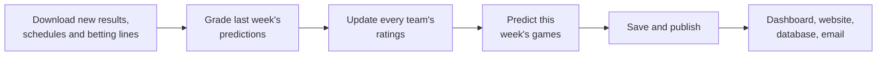
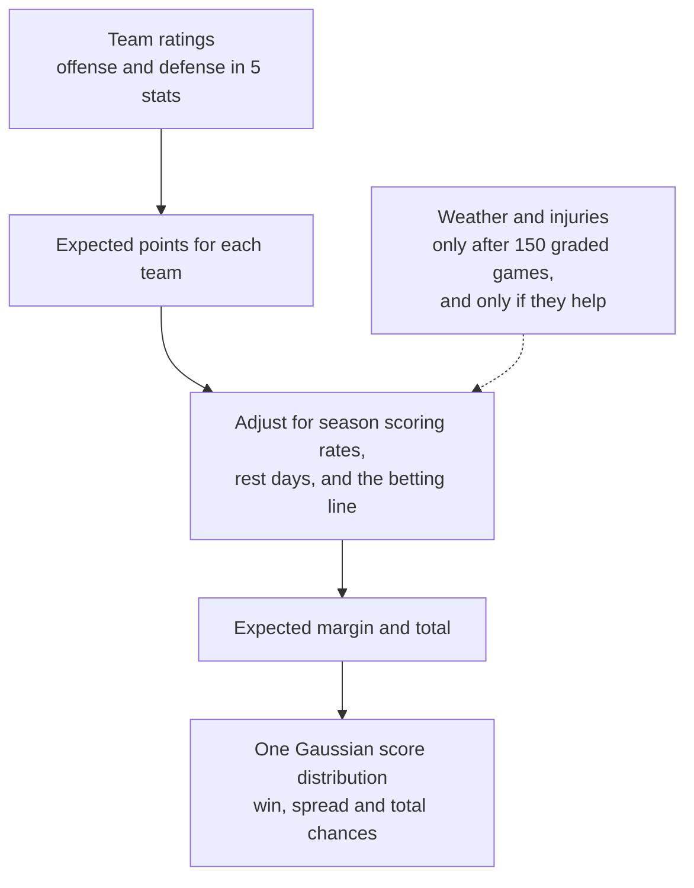

# FieldQuant FBS Forecast Desk

This project predicts every FBS-versus-FBS college football game in the 2026 season. Every Sunday at 10 AM Central time it downloads the latest results, grades last week's predictions against what actually happened, and predicts the coming Monday-to-Sunday games.

For each game it gives:

- the expected score for each team and the pick,
- the chance each team wins,
- the chance each team covers the spread and the chance the game goes over the total, when a betting line was recorded before the forecast,
- a hypothetical betting suggestion. The project never places bets.

Predictions, final results and hypothetical betting returns are stored as separate records, so a prediction is never changed after the game is played.

## Where to see the forecasts

- **Streamlit dashboard** at `http://localhost:8501`. It shows the latest forecasts, past results, and the files behind each run. The code is in `dashboard/`.
- **Public website** on Vercel. It is a React app in `web/` that reads `web/public/forecasts.json`.
- **SQLite database** at `artifacts/cfb_forecast.sqlite`, table `forecast_log`.
- **Email and Datadog**, only when they are configured (see [Outputs](#outputs)).

## How the project fits together

Each Sunday run does the same five things in order.



1. **Download.** Schedules, final scores and per-game team stats come from SportsDataverse. Weather, injuries, rosters, team stats and current betting prices for this week's games come from ESPN and the other sources listed under [Data sources](#data-sources).
2. **Grade.** Last week's saved predictions are compared with the final scores. Accuracy, probability scores and hypothetical betting returns are saved. Games that have not finished stay pending.
3. **Update ratings.** Every finished game moves both teams' ratings, as explained in the next section.
4. **Predict.** Expected scores, win chances, and spread and total chances are calculated for each game this week.
5. **Publish.** The forecast is saved to its own folder and sent to the dashboard, the website file, the database and, when configured, email and Datadog.

## How one game is predicted



**1. Team ratings.** Every FBS team has an offense rating and a defense rating for five stats: points, yards per play, yards per pass, yards per rush, and first-down rate. After each game, both teams' ratings move toward what happened. A rating the model is unsure about moves more than a well-established one, and a good game against a strong defense counts for more than the same game against a weak one. Home field is worth 2.5 points, and neutral sites get none. Each week every rating drifts slightly back toward average. 21 days before each season starts, ratings are pulled further back toward average to account for roster and coaching changes; how far is chosen by testing on the 2024 season.

**2. Expected points.** A regression turns the two teams' ratings into expected points for each side. The learning stage proposes refits with recent games counting more. It fits the candidate without the latest held-out games and checks its log loss on them: if the candidate is no worse than the current regression on those games, the status is `promoted` and the candidate takes over; otherwise the status is `retained` and the current regression stays in use. Forecasting uses whichever regression is selected; the Bayesian team ratings still update as results arrive.

**3. Adjustments.** The expected margin and total are then shifted using:

- each team's average points scored and allowed, yards per play, and similar per-game rates. A team's first game of a season starts from last season's averages, and each game this season updates them;
- each team's days of rest;
- the betting spread and total, when one was recorded before the forecast.

The model learns how much each of these matters from past games. Each historical score location used to learn adjustments comes from a regression fitted on earlier seasons only. When there is too little history, the model keeps its unadjusted score location. Missing-input indicators let it distinguish an unavailable stat from an observed average. Past games use their real closing spread and total, downloaded from the SportsDataverse ESPN betting files. A game this week only uses a line that was captured before the forecast was made. The existing no-line parameter branch handles games without a captured line.

**4. Win chance.** The win chance comes from the same Gaussian score distribution used for spreads and totals. A separate logistic winner curve cannot override it. Requesting other games alongside a matchup does not change that matchup's forecast.

**5. Spread and total chances.** These come from a bell curve centred on the expected margin and total. Whole-number lines can push. No scores are simulated.

**6. Weather and injuries.** These are recorded for every game, but there is no downloadable history of them to learn from. They can only change a prediction once the project has saved at least 150 graded games across at least 3 Sunday runs. Even then, they are used only if they improve accuracy on the most recent graded week. Their bounded effect adjusts the score margin while preserving the projected total; win, spread and total chances are then recalculated together.

The Bayesian rating updates and Gaussian score approximation remain in place. Expected scores are also exposed as Poisson rate parameters; production probabilities use the Gaussian approximation with historical residual covariance, not an exact Poisson posterior. See [the model contract](docs/MODEL_CONTRACT.md) for equations and the limited ideas adapted from CRAFT.

Before a run trusts any number, it checks timing: a result only counts once it was available before the forecast (kickoff plus 8 hours, unless the real finish time is known), a betting line only counts if it was seen before the forecast and before kickoff, and a run refuses to start if a source marks a future game as finished.

### How the settings were chosen

The model is built from past seasons in this order:

| Seasons | Used for |
|---|---|
| Earliest downloaded season | Starting point for the ratings and the scale of each stat |
| 2022 and 2023 | Fitting the expected-points regression |
| 2024 | Choosing the rating settings and the regression strength |
| 2025 | Measuring the model on a season it was not fit on, and comparing it with the strength model below |
| 2026 | The season being predicted |

The model is then refit through 2025 before predicting 2026, and the expected-points regression is refit again at every forecast. Because 2025 was used to choose between models, it is not a fully untouched test of the final choice.

A separate team strength model (opponent-adjusted margins, with a 365-day half-life, an 8-game ridge penalty and a 3-point home edge) is fitted alongside and kept for comparison. Win chances always come from the forecasting model described above, read off the fitted logistic curve from the score margin; the strength model never sets a win chance.

## Repository layout

Each top-level folder has one job:

| Folder | What it holds |
|---|---|
| `src/cfb_forecast/` | The Python package. Subfolders: `ingest/` (data collection), `modeling/` (ratings, forecast and context model), `odds/` (betting math and market lines), `evaluation/` (backtests and validation), `pipeline/` (Sunday run and publishing), `monitoring/` (data watchdog), `storage/` (SQLite). |
| `tests/` | The pytest suite. |
| `dashboard/` | The Streamlit dashboard and its Docker image. |
| `web/` | The public React board, built by Vercel from `vercel.json`. |
| `sql/` | The SQLite schema applied on connect. |
| `r/` | The R weekly report. |
| `scripts/` | Shell and Python helpers, grouped as `setup/` (install), `run/` (forecast and dashboard runs), `checks/` (dataset and source checks) and `workspace/` (workspace tools). |
| `deploy/` | Deployment config: `caddy/` for the HTTPS proxy, `datadog/` for log intake, `bridge/` for Kubernetes manifests. |
| `docs/` | `ARCHITECTURE.md` and `RESULTS.md`. |
| `.github/` | GitHub Actions workflows and issue templates. |

`Dockerfile`, `docker-compose*.yml`, `docker-bake.hcl`, `pyproject.toml` and `vercel.json` stay at the root because Docker, pip and Vercel look for them there. The CLI commands (`cfb-forecast`, `python -m cfb_forecast`) keep working after the move.

## Data sources

| Source | What it provides | How it is used |
|---|---|---|
| [SportsDataverse](https://github.com/sportsdataverse/sportsdataverse-data) | Schedules, final scores, per-game team stats, ESPN closing spreads and totals | Team ratings, team rates, and learning how lines relate to final scores |
| ESPN public API | Final scores, weather, rosters, depth charts, injuries, player leaders, team stats, current betting prices | Grading, this week's game inputs, and betting prices |
| [Open-Meteo](https://api.open-meteo.com/v1/forecast) | Venue weather forecast | Weather when ESPN has none |
| [FootballDB](https://www.footballdb.com/college-football/stats/index.html) | Team offense, defense and scoring tables, and player stats | Game inputs |
| [cfbtrack](https://cfbtrack.com/) | Current team and player season stats | Game inputs |
| [CollegeFootballData](https://collegefootballdata.com/) | Lines, weather, team and player stats | Collected only when `CFBD_API_KEY` is set. Get a key at `https://collegefootballdata.com/key` |
| cfbtxt and mrtimo schedule pages | Weekly schedules | Cross-checking the schedule |
| cfbfastR, radsportsanalytics, cfbtracker, cfbresults, college-football-results, collegefootballdb, cfbstats, FanDuel research | Reference pages | Saved for reference when sources are collected, not used in calculations |

Missing values stay missing. The project never invents a score, a betting price, an injury, a lineup, a weather reading, or a player's value. An empty injury report means the report was unavailable, not that every player is healthy. A roster does not confirm who starts.

Downloaded history can include later corrections, so old records do not always show exactly what was known at the time.

## Running it

### On Linux (WSL)

```bash
cd /mnt/c/Users/brian/cfb-forecast
source /home/brian/.venvs/cfb-forecast/bin/activate
python -m pip install -r requirements-tested.txt
python -m pip install -e '.[test]'
```

Run the Sunday forecast:

```bash
OPENBLAS_NUM_THREADS=1 \
OMP_NUM_THREADS=1 \
python -m cfb_forecast sunday-run --season 2026
```

Start the dashboard:

```bash
python -m pip install -r dashboard/requirements.txt
streamlit run dashboard/app.py
```

Run `python -m cfb_forecast --help` to see every other command, such as `weekly-forecast`, `results-refresh`, `publish-update` and `probability-audit`.

To keep data and results somewhere else, pass the folders explicitly:

```bash
python -m cfb_forecast sunday-run --season 2026 --data runtime/data --artifacts runtime/artifacts
CFB_ARTIFACTS_DIR=runtime/artifacts streamlit run dashboard/app.py
```

### What the first run does

The first run downloads SportsDataverse schedules and team stats for every season from 2000 through 2025, then the 2026 season and its play-by-play. It also downloads the ESPN closing spreads and totals for 2000 through 2026 into `data/market_closing_history.csv`, skipping seasons that have no file. Then it builds the model from past seasons, measures how it did historically, and predicts the coming week.

Later runs reuse the past seasons and the model already on disk, and always refresh the current season and the closing lines. Use `--no-refresh` to skip re-downloading schedules, results and closing lines.

No sample data or made-up results are included. Downloaded data, models and reports are created at run time and are not stored in git.

Each week's forecast is saved once. Running the same week again does not overwrite it. A run that fails stays in `artifacts/work/` and can be retried. Only one run can write at a time.

### With Docker

Build the images, run the forecast, and start the dashboard:

```bash
mkdir -p data artifacts
docker compose build
docker compose run --rm cfb-forecast sunday-run --season 2026
docker compose up cfb-dashboard
```

From Ubuntu WSL, use `docker.exe` in place of `docker`, because the Linux `docker` command is not installed inside WSL. Use `docker compose up --pull always` to pull fresh images first.

Docker Desktop must be allowed to share `C:\Users\brian\cfb-forecast`, including its `data` and `artifacts` folders.

Compose runs four services:

| Service | What it does |
|---|---|
| `cfb-forecast` | One-off forecast commands such as `sunday-run` and `publish-update` |
| `cfb-api` | FastAPI service on port 8000 |
| `cfb-data-watchdog` | Records data file checksums in SQLite and keeps watching |
| `cfb-dashboard` | Streamlit dashboard on port 8501 |

The forecast service mounts `data` and `artifacts` read-write. The dashboard mounts them read-only. `docker-compose.yml` is the source of truth, and these environment variables change its defaults:

| Variable | Default |
|---|---|
| `CFB_DATA_DIR` | `./data` |
| `CFB_ARTIFACTS_DIR` | `./artifacts` |
| `CFB_IMAGE` | `cfb-forecast:local` |
| `CFB_DASHBOARD_IMAGE` | `cfb-forecast-dashboard:local` |
| `CFB_UID` and `CFB_GID` | `10001` |
| `CFB_DASHBOARD_UID` and `CFB_DASHBOARD_GID` | `10002` |
| `CFB_DASHBOARD_PORT` | `8501` |
| `CFB_API_PORT` | `8000` |
| `DD_API_KEY` and `DD_SITE` | empty and `datadoghq.com` |

Both images start from `python:3.12-slim`. The forecast image installs the package with its API extras into `/app`, plus R (`r-base-core`) for the R validation step, and runs as UID and GID 10001. The dashboard image installs Streamlit from `dashboard/requirements.txt`, which allows any 1.x release from 1.40 on. A build on 2026-10-15 installed Streamlit 1.66.0.

## Automation

| Workflow | What it does |
|---|---|
| `.github/workflows/sunday.yml` | Runs `sunday-run` on Sundays. It is scheduled at both 15:00 and 16:00 UTC so that one of them lands on 10 AM Central time across daylight saving changes, and the run skips itself at any other hour. A manual run starts right away. |
| `.github/workflows/tests.yml` | Installs the package, runs the tests on Python 3.11 and 3.12, checks `python -m cfb_forecast --help`, and builds the website in `web/` |
| `.github/workflows/docker.yml` | Builds both images, checks that each one starts its commands, and pushes them to `ghcr.io` on pushes to `main` and on version tags |
| `.github/workflows/external-sources.yml` | Collects the weekly public sources |

A workflow only runs when it is enabled on the repository's Actions tab. A workflow that was turned off there stays off until it is turned on again, even if its file has not changed. GitHub can also delay scheduled runs.

The Sunday workflow saves the downloaded data, models, past predictions and reports as a GitHub artifact, and the next run restores the newest one. These artifacts expire after 90 days, so export them if the service will be paused longer than that.

## Outputs

| Path | What it holds |
|---|---|
| `artifacts/runs/<season-date>/forecasts.csv` | The week's predictions, the betting prices used, and each hypothetical betting decision |
| `artifacts/runs/<season-date>/inputs/` | The raw downloads and game inputs the forecast used |
| `artifacts/runs/<season-date>/run_manifest.json` | Run times and checksums of every source, model and prediction file |
| `artifacts/runs/<season-date>/validation.csv` and `.json` | Final scores matched to the unchanged predictions, with accuracy and betting results |
| `artifacts/latest/` | The most recent completed run, for the dashboard |
| `artifacts/training/` | The model and its historical comparisons |
| `web/public/forecasts.json` | The file the website reads |
| `artifacts/cfb_forecast.sqlite` | The database: published forecasts in `forecast_log`, model versions in `learning_versions` and `training_examples`, and source records in `source_registry`, `source_retrievals` and `source_files`. The schema is `sql/schema.sql`. |
| `artifacts/logs/datadog.jsonl` | One log line each time a forecast is published |

Every completed run publishes the same forecast to the database, `artifacts/latest/forecast_board.json`, the website file, the dashboard's forecast log, the Datadog log file, and an email to `bngomez@ieee.org`. The email is sent only when `CFB_SMTP_HOST` and `CFB_SMTP_PASSWORD` are set, and Datadog receives the log only when `DD_API_KEY` is set (through `deploy/datadog/conf.yaml`). Otherwise both are kept on disk.

To publish an existing run again without recalculating it:

```bash
python -m cfb_forecast publish-update --run artifacts/weekly/2026-week-7 --run-id 2026-week-7 --fetch-sources
```

## Hypothetical betting rules

The project compares its win chance with the sportsbook's moneyline after removing the bookmaker's margin. A game becomes a hypothetical bet only when:

- the model's win chance is at least 2 percentage points higher than the book's fair chance,
- the expected return at the offered price is positive,
- weather, injury, lineup, player and team inputs are all available for the game.

The suggested stake is a quarter of the Kelly amount, capped at 1% of the bankroll per game and 5% per week. These are fixed settings, not evidence that the bets would make money. Grading always uses the price saved with the prediction. Games with no price get no return figure. Prices can move a lot between Sunday and kickoff.

## Checking the predictions

When a week is graded, the project reports how often it picked the winner, its log loss and Brier score (two measures of how good the win chances were), how far off the margin was, and calibration by probability range. Each calibration bin also gets the 95% range luck alone would allow and a flag when the hit rate falls outside it, plus Spiegelhalter's z-test on the whole set. Log loss and Brier are tracked week by week on the results page so drift shows up over time. Spread results are reported only for games with a real recorded spread. These accuracy measures are kept separate from the betting results.

### Probability audit

This command tests whether the win chances in an exported prediction file could be better calibrated, without changing the model in use:

```bash
python -m cfb_forecast probability-audit \
  --input my_actual_predictions.csv \
  --probability-column score_p \
  --outcome-column home_win \
  --max-change 0.05 \
  --stress-radius 0.1 \
  --out artifacts/probability-research
```

The input file needs `game_id` (unique), `season` (a whole number), the named probability and outcome columns, and either `as_of` and `kickoff` or `forecast_cutoff` and `start_date`. Each season is checked with a correction fitted only on earlier seasons, so a file with one season can suggest a correction but cannot show that it helps.

The command writes `predictions.csv`, `metrics.csv`, `calibration.csv`, `summary.json` and, when there are enough games, `candidate_calibrator.json`. Adding `--model artifacts/training/model` also writes a separate candidate model next to the audit. The model in use is never changed.

## Tests

```bash
cd /mnt/c/Users/brian/cfb-forecast
source /home/brian/.venvs/cfb-forecast/bin/activate
python -m pytest -q
python -m cfb_forecast --help
```

On 2026-10-15 the suite reported `89 passed, 1 skipped` in a clean checkout. The tests use small hand-made examples to check timing rules, betting math, calibration limits, source archives and that no future information leaks into a prediction. Those examples are never used by the forecast itself.

## Local setup reference

| Item | Value |
|---|---|
| Project folder | `/mnt/c/Users/brian/cfb-forecast` (Windows: `C:\Users\brian\cfb-forecast`) |
| Linux Python environment | `/home/brian/.venvs/cfb-forecast` (Python 3.12.3, pip 26.2.1) |
| Windows Python environment | `C:\Users\brian\miniforge3\envs\cfb-python` |
| Package | `cfb-forecast` 0.4.0, source in `src/cfb_forecast`, command `cfb-forecast` |
| Data and results folders | `data/` and `artifacts/` in the project folder |
| Docker images | `cfb-forecast:local` and `cfb-forecast-dashboard:local`, app folder `/app` |
| Compose network | `cfb-forecast_default` |
| Ports | Dashboard 8501, API 8000 |
| Container users | Forecast UID and GID 10001, dashboard UID and GID 10002 |

The package is installed in editable mode from the git checkout, so code changes take effect without reinstalling.
