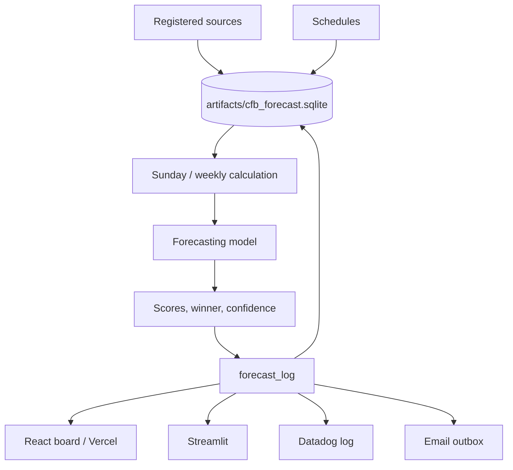

# FieldQuant FBS Forecast Desk

Real-data forecasting service for the 2026 FBS season.

Every Sunday at 10:00 America/Chicago the service:

1. Collects the latest schedules, results, weather, injuries, and market lines
2. Validates previously saved predictions against final scores
3. Produces forecasts for the coming Monday–Sunday slate

Predictions, actual results, and hypothetical betting diagnostics are stored as separate records.

**Live board:** https://cfb-forecast.vercel.app

## Quick start

```bash
# Install (editable)
pip install -e '.[test]'

# Run the Sunday service for the 2026 season
OPENBLAS_NUM_THREADS=1 OMP_NUM_THREADS=1 \
  python -m cfb_forecast sunday-run --season 2026

# Launch the Streamlit dashboard
CFB_ARTIFACTS_DIR=artifacts streamlit run dashboard/app.py
# → http://localhost:8501
```

Docker and Compose files are also provided. See `docker-compose.yml`.

## How the forecast works

One production score model drives everything.

- A hierarchical Gaussian team state (offense / defense) is maintained with Kalman updates.
- Pregame team and player rates, rest, weather, injuries, and eligible market lines adjust the expected score location.
- The same location is used as both the Gaussian mean and the Poisson rate.
- Win, cover, and total probabilities are calculated analytically from the resulting joint Gaussian.
- Missing inputs stay missing; the system never invents weather, injury probabilities, or starting lineups.

Full mathematical contract: [docs/MODEL_CONTRACT.md](docs/MODEL_CONTRACT.md)  
Architecture overview: [docs/ARCHITECTURE.md](docs/ARCHITECTURE.md)  
Design status vs. target equations: [docs/design/README.md](docs/design/README.md)



## Main workflows

| Command | Purpose |
| --- | --- |
| `python -m cfb_forecast sunday-run --season 2026` | Validate prior slate and produce the next week |
| `python -m cfb_forecast publish-update --run DIR --run-id ID` | Persist an existing run to SQLite, apps, and logs |
| `cfb-forecast update-database --season 2026` | Refresh schedules and registered source tables |
| `cfb-data-watchdog` | Record file checksums for data integrity |

The SQLite database lives at `artifacts/cfb_forecast.sqlite`. Schema is applied from `sql/schema.sql` on connect.

## Data sources

| Source | Role |
| --- | --- |
| SportsDataverse / cfbfastR | Schedules, final scores, advanced team stats |
| CollegeFootballData | Lines, ratings, additional stats |
| ESPN public endpoints | Live scores, weather, rosters, injuries, depth charts, displayed prices |
| FootballDB / cfbtrack.com | Team and player season statistics |
| Open-Meteo | Venue weather when ESPN has none |

Exact snapshot URLs, sizes, and SHA-256 checksums are recorded in [docs/data-sources.json](docs/data-sources.json). The `data/` directory itself is not committed.

Missing external values remain missing. The system does not invent prices, injury probabilities, lineup assumptions, or synthetic results.

## Model development notes

- Warm-up season: 2021
- Fitting seasons: 2022–2023
- Calibration / settings: 2024
- Model comparison: 2025
- Prediction season: 2026

A separate time-decayed ridge strength model (365-day half-life, 8-game ridge, 3-point home edge) is kept for comparison only. Production win probabilities always come from the score model.

Context learning (weather, player/team rates, availability) is gated: a candidate must improve validation log-loss on held-out weeks before it can adjust the production forecast.

## Testing and CI

```bash
pytest
```

GitHub Actions workflows cover tests, Docker image builds, external-source collection, and the Sunday automation.

## Configuration & secrets

| Variable | Purpose |
| --- | --- |
| `DD_API_KEY` | Enables Datadog intake |
| `CFB_SMTP_HOST` / `CFB_SMTP_PASSWORD` | Enables email delivery |
| CollegeFootballData API key | Configured in `pyproject.toml` or environment |

## License & contact

See repository license. Questions: bngomez@ieee.org
