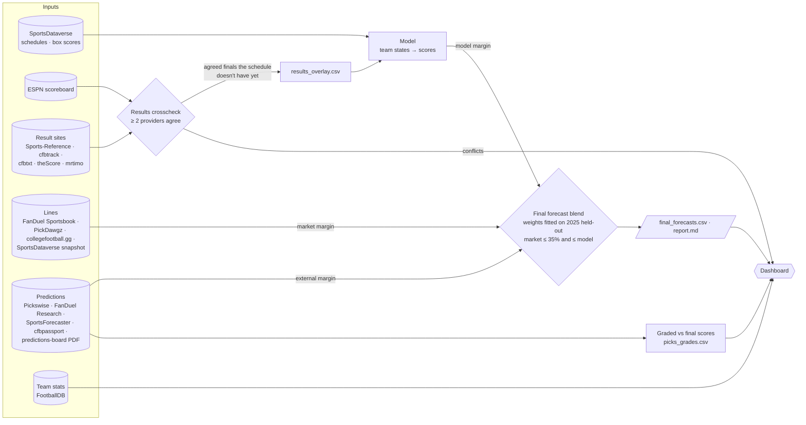
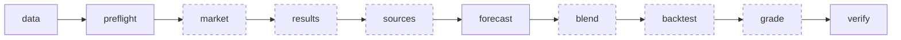
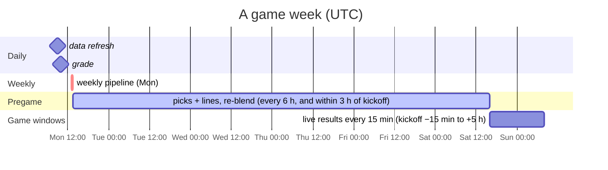
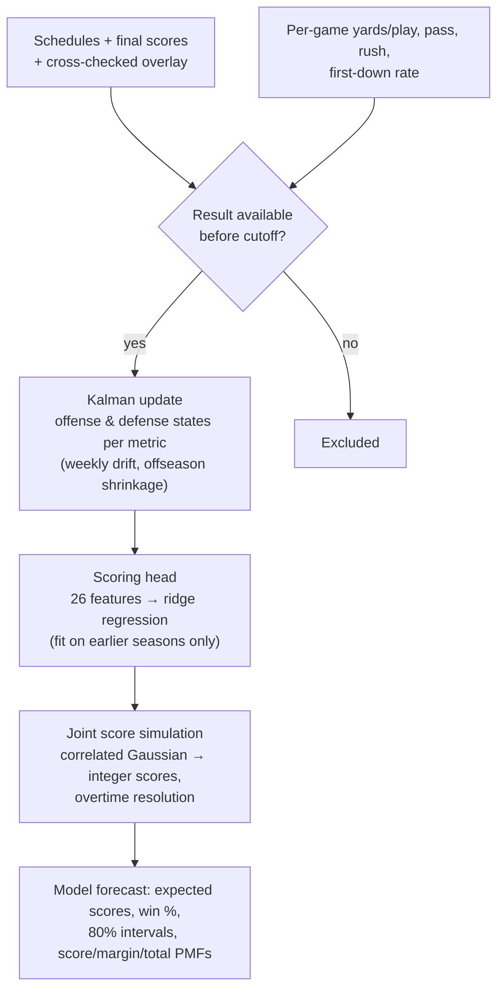
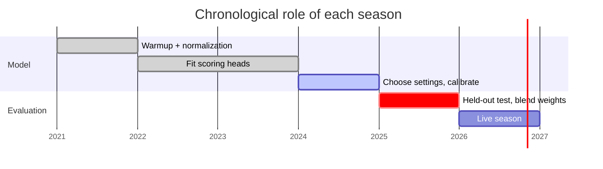

# CFB Forecast

College football forecasting that learns time-varying offense and defense strength for every FBS team, simulates **joint score distributions**, and produces a **final forecast** that also uses the betting market and external prediction sites. The market and external sources inform the forecast but never decide it.

| | |
|---|---|
| **Model inputs** | SportsDataverse schedules and ESPN advanced box scores; final scores cross-checked across ESPN and external result sites |
| **Model** | Kalman-filtered team states → ridge scoring head → correlated score simulation |
| **Final forecast** | Model margin blended with the market line and external predictions, using weights fitted on held-out games; market weight capped |
| **Outputs** | Expected scores, win probability, margins, intervals and score PMFs per game, plus a weekly `report.md` |
| **Automation** | Built-in scheduler driven by the game calendar, running as its own container |
| **2025 held-out** | Model: 73.0% winners, log loss 0.541. Final blend (cross-validated): log loss 0.518, margin MAE 11.95 vs 12.43 for the model alone |

Forecasts are research outputs. No betting edge has been established.

---

## How the sources are used



| Source type | What it does | Where it enters |
|---|---|---|
| **Schedules + box scores** (SportsDataverse) | Train and update team strength | Model |
| **Final scores** (ESPN + result sites) | Cross-checked. A final that ≥ 2 providers agree on, which the schedule doesn't have yet, updates team states, stamped with when those providers agreed. Schedule scores are never overwritten; disagreements are flagged, never averaged | Model (via `data/results_overlay.csv`) |
| **Market lines** (sportsbook pages, SportsDataverse snapshot) | One input to the final margin, capped at 35% weight and never more than the model's own weight | Final forecast |
| **External predictions** (pick sites, PDF board) | Their mean projected margin (from predicted scores, spreads or win %) is one input to the final margin. Its weight scales with how many sources cover the game | Final forecast |
| **Team stats** (FootballDB) | Reference tables on the dashboard | Dashboard |

Every external input is used only if it was observed **before kickoff** and before the forecast's information cutoff.

### Final forecast

`final margin = w_model · model + w_market · market + w_external · external`

The weights are fitted on the 763 held-out 2025 games that have all three signals. They are non-negative and sum to one; the market's weight is at most `CFB_MARKET_MAX_WEIGHT` (0.35) and never above the model's. When a game lacks a signal, the remaining weights are renormalized and the cap re-applied. With no outside information, the final forecast is exactly the model's. Win probability is `Φ(final margin / σ)`, with σ fitted on the same games. Totals remain the model's, because there is no pregame total history to validate a blend against.

| Held-out 2025, 5-fold cross-validated by week | Margin MAE | Log loss | Brier | Winners |
|---|---:|---:|---:|---:|
| Model alone | 12.43 | 0.538 | 0.182 | 73.0% |
| External average alone | 12.00 | 0.518 | 0.175 | 72.0% |
| Market alone | 11.88 | 0.517 | 0.175 | 73.8% |
| **Final blend** (model 24% · market 24% · external 52%) | **11.95** | **0.518** | **0.175** | **73.7%** |

The blend gains most of the market's accuracy while keeping the market to a minority share. Refit any time with `cfb-forecast blend-fit` (spec: `artifacts/backtest/blend/blend.json`).

## Pipeline

`cfb-pipeline <action>` runs stages in-process, the same way on a laptop and in the container.



| Action | Stages | Purpose |
|---|---|---|
| `weekly` | all of the above | Full weekly run |
| `results` | data → results → sources (result sites) → check | Live scores; refreshes the crosscheck and overlay |
| `pregame` | data → market → sources (picks, lines) → blend | Capture predictions and lines before kickoff and re-blend the latest forecast |
| `grade` | data → grade | Grade every pick source against final scores, next to the model |
| `sources` | data → sources (all) | Collect every external site once |
| `backtest` | data → preflight → backtest | Re-forecast and grade every completed week |
| `data` | data | Download or refresh season inputs |

Dashed stages are optional: a failure (for example, a site that blocks automated requests) is logged and the run finishes `degraded`. A required stage failure stops the run with a nonzero exit code. Every run writes a receipt to `artifacts/pipeline/` and a log to `artifacts/logs/`.

## Automation

`cfb-forecast scheduler` (the `scheduler` container) reads the season's kickoff times and runs each job when it is due. All times are UTC and configurable in `.env`.



| Job | When | Action |
|---|---|---|
| `live-results` | Every 15 min while any FBS game is between 15 min before kickoff and 5 h after | `results` |
| `pregame` | Every 6 h while a game is within 7 days, and hourly in the 3 h before kickoff | `pregame` |
| `weekly` | Monday 13:00 | `weekly` |
| `grade` | Daily 10:00 in season | `grade` |
| `data` | Daily 09:00 | `data` |

Off-season, only `weekly` and `data` run. The scheduler keeps its state, a heartbeat (used by the container healthcheck) and a single-instance lock in `artifacts/scheduler/`. Without Docker, run `cfb-forecast scheduler`, or `cfb-forecast scheduler --once` from cron or Task Scheduler. `--status` shows what is due.

## Quick start

### Docker (recommended)

```bash
cp .env.example .env               # optional: change season, draws, schedule, market cap
make docker-build                  # docker compose build: engine + dashboard images
make up                            # scheduler + dashboard on http://localhost:8501
make logs                          # follow the scheduler
docker compose run --rm pipeline   # run the weekly pipeline now
docker compose run --rm cfb-forecast sources-list
```

The engine image contains the `src/` library (an editable install, so `/app/src` is the code that runs), the pipeline, the scheduler, logging, the bundled data, the production model and blend, the dashboard code and the tests. To test local code edits without rebuilding, run `docker compose run --rm -v ./src:/app/src cfb-forecast …`. Container logs rotate (10 MB × 5), and run logs persist in `artifacts/logs/`.

### Local Python (3.11+)

```bash
make install       # pip install -e ".[dev]"
make test          # 46 tests
make weekly        # refresh, collect, forecast, blend, grade
make scheduler     # automation in the foreground
make dashboard     # http://localhost:8501
```

To publish the dashboard with HTTPS: `CFB_DOMAIN=forecast.example.org docker compose --profile public up -d` (Caddy, [`deploy/Caddyfile`](deploy/Caddyfile)).

## External sources

Run `cfb-forecast sources-list` to see every registered site.

- **Fetching:** each fetch checks robots.txt, rate-limits per host and retries. The raw page is saved with its SHA-256 and retrieval time under `data/sources/raw/`, so `sources-collect --offline` can re-interpret saved pages without refetching.
- **Interpretation:** works on any layout: table rows, one- or two-line scoreboards, text result lists, embedded JSON with home/away structure, and PDFs. A row is accepted only when both teams resolve (aliases, ranks and "St." handled) to a scheduled matchup.
- **Classification:** numbers are classified as scores, spreads, moneylines, totals or win probabilities and attached to the right team. A score for a game that hasn't started, a pick published after kickoff or a tied final is rejected.
- **JavaScript-only or blocking sites:** some pages render in JavaScript or refuse automated requests; FanDuel does both. Those are reported as `no-records` or `http-403` in `data/sources/collections/latest.json`. For them, save the page from a browser and import it:

```bash
cfb-forecast sources-import --season 2026 --source fanduel_sportsbook --file ~/Downloads/fanduel.html
cfb-forecast sources-import --season 2026 --source predictions_board --file "CFB Predictions Board.pdf" --observed-at 2026-10-07T15:00:00Z
```

| Output (`data/sources/`) | Contents |
|---|---|
| `results.csv` · `picks.csv` · `lines.csv` | Every accepted record with source, retrieval time and the evidence text |
| `results_crosscheck.csv` | Per game: each provider's latest final, agreement with each other and with the schedule |
| `picks_grades.csv` | Accuracy, Brier score and score error per pick source, with the model's numbers on the same games |
| `team_stats/<source>.csv` | Team stat tables |
| `collections/latest.json` | Per-source status of the last collection |

## How the model works





A result can update team states only if it became available **strictly before** the forecast cutoff (kickoff + 8 h when the real time is unknown). Equations and data policies are in [docs/METHODOLOGY.md](docs/METHODOLOGY.md). The model's 2025 evaluation is in [docs/RESULTS.md](docs/RESULTS.md). The optional 24-hour chronological ledger tools are described in [docs/CHRONOLOGY.md](docs/CHRONOLOGY.md).

**2025 held-out model results** (808 FBS-vs-FBS games, heads fitted through 2024):

| Model | Winner accuracy | Log loss | Brier | Margin MAE | Total MAE |
|---|---:|---:|---:|---:|---:|
| Calibrated Elo | 69.55% | 0.5750 | 0.1965 | — | — |
| Score-state | 72.03% | **0.5377** | **0.1814** | 12.50 | **12.98** |
| PBP-state (selected) | **73.02%** | 0.5406 | 0.1830 | **12.41** | 12.99 |

**2026 to date** (committed snapshot `artifacts/backtest/season-2026/summary.json`): 215 graded games over 4 weeks, 80.9% winners, Brier 0.148, margin MAE 12.9.

## Configuration

Defaults are in [`.env.example`](.env.example).

| Variable | Default | Meaning |
|---|---|---|
| `CFB_FORECAST_SEASON` | `2026` | Season (the scheduler also accepts `auto`) |
| `CFB_FORECAST_DRAWS` | `50000` | Monte Carlo draws per game |
| `CFB_SOURCES` | `all` | External sources to collect: `all`, `none` or a comma list |
| `CFB_MARKET_MAX_WEIGHT` | `0.35` | Cap on the market's share of the final margin |
| `CFB_EXTERNAL_FULL_SOURCES` | `3` | External sources needed for the full external weight |
| `CFB_LIVE_MINUTES` · `CFB_PREGAME_HOURS` | `15` · `6` | Scheduler intervals |
| `CFB_WEEKLY_DAY` · `CFB_WEEKLY_HOUR` · `CFB_GRADE_HOUR` · `CFB_DATA_HOUR` | `mon` · `13` · `10` · `9` | Scheduler slots (UTC) |
| `CFB_LOG_LEVEL` · `CFB_LOG_DIR` | `INFO` · `artifacts/logs` | Logging |
| `CFB_REFRESH_DATA` | `1` in Docker | Re-download season inputs before the weekly run |
| `CFB_DATA_DIR` · `CFB_ARTIFACTS_DIR` | `./data` · `./artifacts` | Mounted folders |
| `CFB_DASHBOARD_PORT` · `CFB_DOMAIN` | `8501` · `localhost` | Dashboard port, HTTPS hostname |

## Command reference

Run `cfb-forecast <command> --help` for every option. In Docker, use `docker compose run --rm cfb-forecast <command>`.

| Group | Commands |
|---|---|
| Pipeline & automation | `pipeline {weekly,results,pregame,grade,sources,backtest,data}` (alias `cfb-pipeline`), `scheduler [--once \| --status \| --run JOB]`, `healthcheck` |
| Final forecast | `blend-fit`, `blend-apply --forecast DIR` |
| External sources | `sources-list`, `sources-collect [--source …] [--tag results\|picks\|lines\|stats] [--offline]`, `sources-import --source NAME --file PATH [--observed-at …]`, `sources-grade` |
| Data | `fetch --seasons 2026 [--refresh]`, `results-refresh`, `preflight` |
| Model | `backtest` (`make reproduce`), `distribution-backtest`, `weekly-forecast`, `forecast`, `forecast-advance`, `season-backtest` |
| Market | `market-init`, `market-import`, `market-snapshot-sdv`, `market-backfill-sdv` |
| Chronological ledger | `holdout-*`, `chronology-*`, `prospective-run` |

## Repository layout

```text
cfb-forecast/
├── src/cfb_forecast/
│   ├── cli.py · pipeline.py · scheduler.py · logs.py   commands, stages, automation, logging
│   ├── blend.py                                        final forecast (model + market + external)
│   ├── sources/                                        external sites
│   │   ├── registry.py   sites and how each is interpreted
│   │   ├── fetch.py      robots, rate limits, retries, raw snapshots
│   │   ├── extract.py    HTML / JSON / text / PDF → lines
│   │   ├── teams.py      team-name resolution
│   │   ├── interpret.py  results, predictions, lines, team stats
│   │   └── collection.py collect, import, crosscheck, overlay, grading
│   ├── data.py · features.py · ratings.py · model.py · simulate.py · distribution.py   model
│   ├── forecast.py · weekly.py · season_backtest.py · backtest.py · evaluate.py         forecasting and evaluation
│   ├── results.py · market.py                                                           ESPN scores, market history
│   └── holdout.py · chronology.py · collector.py · availability.py                      chronological ledger tools
├── tests/                 model, sources, blend, overlay and scheduler tests
├── dashboard/             Streamlit app (forecast · backtest · external sources) + Dockerfile
├── data/                  bundled inputs, market history, archive; sources/ outputs
├── artifacts/             production model, blend spec, evaluations, forecasts, logs, scheduler state
├── docs/                  METHODOLOGY · RESULTS · CHRONOLOGY
├── deploy/Caddyfile       HTTPS proxy
├── Dockerfile             engine image
├── docker-compose.yml     scheduler · dashboard · pipeline/sources/cli (profile cli) · caddy (profile public)
├── Makefile · pyproject.toml · requirements-tested.txt · .env.example
```

## Data sources

- SportsDataverse releases: [`cfb_schedules`](https://github.com/sportsdataverse/sportsdataverse-data/releases/tag/cfb_schedules), [`espn_cfb_adv_team`](https://github.com/sportsdataverse/sportsdataverse-data/releases/tag/espn_cfb_adv_team), [`espn_cfb_pbp`](https://github.com/sportsdataverse/sportsdataverse-data/releases/tag/espn_cfb_pbp), `espn_cfb_betting`
- [ESPN public scoreboard API](https://site.api.espn.com/apis/site/v2/sports/football/college-football/scoreboard)
- [ssmarathontrading/ncaa_predictions](https://github.com/ssmarathontrading/ncaa_predictions): archived public forecasts and lines, used to fit the blend weights
- External sites in [`sources/registry.py`](src/cfb_forecast/sources/registry.py): Sports-Reference, cfbtrack, cfbtxt, theScore, mrtimo cfb-games, FootballDB, FanDuel Sportsbook and Research, Pickswise, PickDawgz, SportsForecaster, CFB Passport, collegefootball.gg, plus manual imports such as the predictions-board PDF
