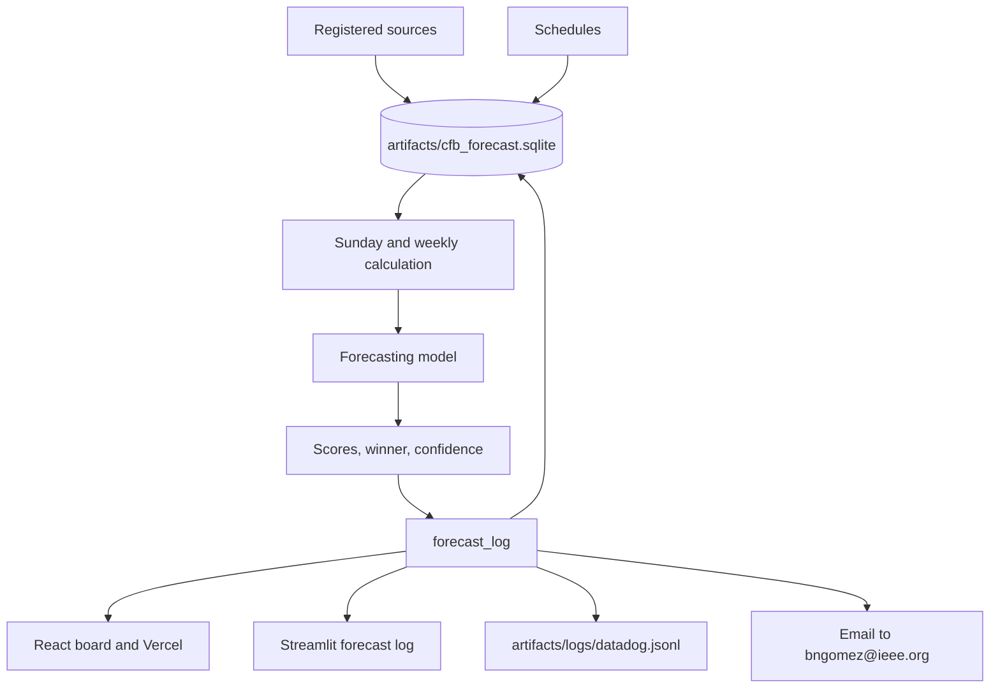
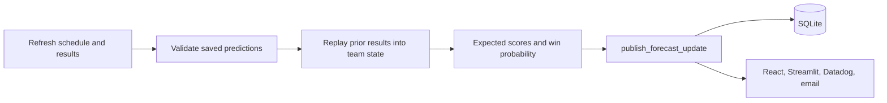
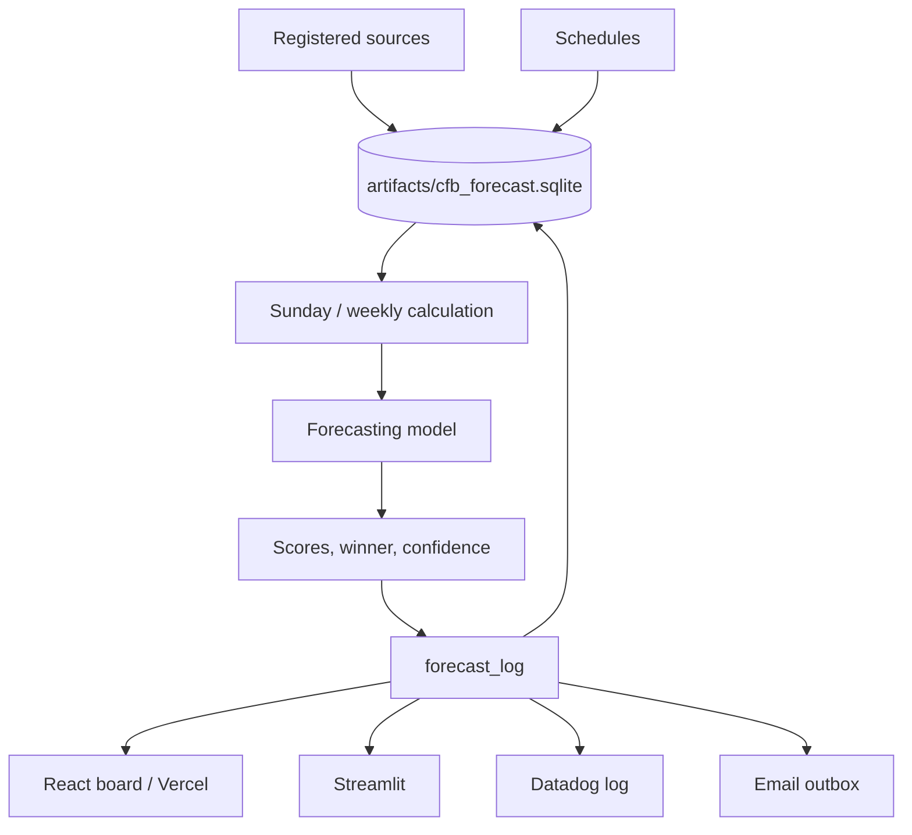

# FieldQuant FBS Forecast Desk

Real-data forecasting service for the 2026 FBS season.

## October 15 repository update

The [design implementation status](docs/design/IMPLEMENTATION_STATUS.md) maps the attached October 12 specification to executable code and the remaining estimation work. The original design and historical project records are retained under `docs/design/`.

The primary forecast now uses football inputs by default. Use `forecast --forecast-mode market_conditioned` for an explicitly separate calculation with market covariates. Both modes retain quotes for comparison and spread/total pricing. Published runs freeze full-precision predictions, numerical inputs, fitted parameters, state and source files; changing a saved run requires a new run ID. `evaluate-run` verifies those files and records later outcomes and errors separately. [Verification results](docs/verification/2026-10-15/README.md) describe this execution.

## Current mathematical implementation

The default forecast now fits **one conditional Gaussian hierarchical posterior**
from team scores and individual player-game observations. Shared player ability,
opponent role-defense and player–opponent matchup effects enter both player
rates and team scoring. Their joint posterior covariance enters score, winner,
spread and total uncertainty. Supplied availability probabilities are integrated
as lineup scenarios with role-specific usage redistribution.

See [the complete mathematics, database contract, assumptions and verification](docs/joint_player_model.md).
The new family is not covered by the previous model's historical accuracy.
`--legacy-score` explicitly reproduces the earlier team-only calculation.
The following service/configuration sections retain operational reference;
where they discuss the earlier ridge or context heads, those describe the
legacy family rather than the new default posterior.

## Actual project configuration

| Field | Value |
| --- | --- |
| Project root | `/mnt/c/Users/brian/cfb-forecast` |
| Python virtual environment | `/home/brian/.venvs/cfb-forecast` |
| Windows environment | `C:\Users\brian\miniforge3\envs\cfb-python` |
| Python version | `3.12.3` |
| pip version | `26.2.1` |
| Package name | `cfb-forecast` |
| Package version | `0.4.0` |
| Python source | `/mnt/c/Users/brian/cfb-forecast/src/cfb_forecast` |
| Runtime data directory | `/mnt/c/Users/brian/cfb-forecast/data` |
| Runtime artifacts directory | `/mnt/c/Users/brian/cfb-forecast/artifacts` |
| Docker application directory | `/app` |
| Main Docker image | `cfb-forecast:local` |
| Dashboard Docker image | `cfb-forecast-dashboard:local` |
| Docker base image | `python:3.12-slim` |
| Compose service | `cfb-forecast` |
| Dashboard service | `cfb-dashboard` |
| Dashboard port | `8501` |
| Dashboard address | `http://localhost:8501` |
| Compose network | `cfb_forecast_default` |
| Forecast container UID | `10001` |
| Forecast container GID | `10001` |
| Test result | See the dated verification record above |

The editable install is the git checkout. On Linux that environment is `/home/brian/.venvs/cfb-forecast`. On Windows it is `C:\Users\brian\miniforge3\envs\cfb-python`.

## Architecture, pipelines, workflows, and sources

The [attachment import record](docs/design/README.md) retains the supplied source design, archive comparison and uploaded change history. The [current implementation status](docs/design/IMPLEMENTATION_STATUS.md) records the executable changes in this update.

The forecast reads game, team and player facts from the same database-backed
history. Versioned player observations resolve game and opponent IDs; roster
snapshots and known pregame context are selected before the information cutoff.
The team/player hierarchy fits a common sparse posterior, then integrates
player/opponent uncertainty and supplied availability scenarios into the game
score distribution. Player-rate projections and game probabilities share those
latent effects. Missing evidence remains explicitly unconfirmed. No separate
ridge correction or independent context probability head is added to this
family. Existing registered public sources retain capture receipts; their pages
must be normalized and identified before they can become player observations.

Forecasts come from one model, with an explicit football-only or market-conditioned input mode. A hierarchical team state sets the score location. Pregame team and player rates from the parquet seasons on disk (2000 through 2025, plus completed games after that) and known-future information (market line, total, rest, weather, and reported injuries) shift that location together. The same location is the Gaussian mean and the Poisson rate. The win probability is the Gaussian probability that the home score exceeds the away score. Spread and total probabilities are analytic Gaussian probabilities. A missing rate stays missing. Every recorded game in the previous season sets that season's mean; every completed game in the current season updates it. Those rates are stored in `team_game_facts` and `player_game_facts`, and the next weekly forecast reads them back into the same hierarchical state, Poisson rates, Gaussian scores, and Gaussian win probability. The prediction board shows kickoff, teams, expected score, winner, and confidence. Spreads and moneylines, team and player statistics, and method notes are separate pages. Weather comes from the ESPN game summary, and from Open-Meteo for the venue when that summary has none. CollegeFootballData lines enter the forecast from the key in `pyproject.toml`. Weather, team stats, and player stats are collected from the same API. FootballDB college offense, defense, scoring, and player pages are collected with the other sources. cfbtrack.com supplies current team and player season stats. A saved model keeps the warmup season it was fit with. Missing history is left missing; it is not replaced with a made-up season.





| Workflow | What it runs |
| --- | --- |
| Sunday service | `python -m cfb_forecast sunday-run` at 10:00 America/Chicago. It validates the previous slate and writes the next one. |
| Weekly forecast | `run_weekly_forecast` calculates one week and publishes that board. |
| Publish update | `python -m cfb_forecast publish-update --run DIR --run-id ID` stores an existing calculation in SQLite, the apps, the Datadog log, and the email outbox. |
| Forecast database | Weekly and Sunday runs store every source in SQLite. The forecast reads that database. |
| Update database | `cfb-forecast update-database --season 2026` writes schedules into `games` and `game_teams` and every registered source into `source_rows`. |
| Data watchdog | `cfb-data-watchdog` records file checksums in `data_files` and `watchdog_events`. |
| Tests | `.github/workflows/tests.yml` installs the package and runs pytest. |
| Docker image | `.github/workflows/docker.yml` builds the local image. |
| External sources | `.github/workflows/external-sources.yml` collects the weekly public sources. |
| Sunday automation | `.github/workflows/sunday.yml` restores the runtime and runs the Sunday service. |

The SQLite file is `artifacts/cfb_forecast.sqlite`. `sql/schema.sql` is the schema applied on connect. The published board is `forecast_log`. Learning rows are `learning_versions` and `training_examples`. The forecast reads `team_game_facts`, `player_game_facts`, `team_play_rates`, and `source_rows`. Source provenance is `source_registry` and `source_retrievals`.

Datadog reads `artifacts/logs/datadog.jsonl` through `deploy/datadog/conf.yaml`. Intake runs only when `DD_API_KEY` is set. Email is sent only when `CFB_SMTP_HOST` and `CFB_SMTP_PASSWORD` are set.

| Source | URL |
| --- | --- |
| cfbfastR | `https://cfbfastr.sportsdataverse.org/` |
| cfbfastR models | `https://github.com/sportsdataverse/cfbfastR-cfb-data/blob/main/models/REGISTRY.md` |
| SportsDataverse | `https://github.com/sportsdataverse/sportsdataverse-data` |
| radsportsanalytics | `https://radsportsanalytics.com/blog/introduction-to-cfb-analytics/` |
| cfbtrack | `https://cfbtrack.com/` |
| cfbtracker | `https://cfbtracker.com/` |
| cfbresults | `https://cfbresults.com/` |
| college-football-results | `https://college-football-results.com/` |
| collegefootballdb | `https://collegefootballdb.com/` |
| cfbstats | `https://cfbstats.com/` |
| collegefootballdata | `https://collegefootballdata.com/` |
| mrtimo schedule | `https://mrtimo.github.io/cfb-games/games-{season}.html` |
| CollegeFootballData key | `https://collegefootballdata.com/key` |
| CollegeFootballData ratings | `https://api.collegefootballdata.com/ratings/core` |
| cfbtxt validation | `https://cfbtxt.com/schedule/` |
| FanDuel comparison | `https://www.fanduel.com/research/ncaaf` |
| FootballDB team stats | `https://www.footballdb.com/college-football/stats/teamstat.html?yr={season}&lg=FBS` |
| FootballDB stats index | `https://www.footballdb.com/college-football/stats/index.html` |
| FootballDB player stats | `https://www.footballdb.com/college-football/stats/stats.html?lg=FBS&yr={season}` |
| Open-Meteo | `https://api.open-meteo.com/v1/forecast` |
| ESPN scoreboard | `https://site.api.espn.com/apis/site/v2/sports/football/college-football/scoreboard` |

The exact runtime data snapshots the pipeline downloads — schedules and advanced team summaries for 2021–2026 — are recorded with their URLs, byte sizes, and SHA-256 checksums in [`docs/data-sources.json`](docs/data-sources.json). The `data/` directory itself stays out of source control; that file is the tracked provenance record for it.

## Run with the established Linux environment

From Ubuntu WSL:

```bash
cd /mnt/c/Users/brian/cfb-forecast
source /home/brian/.venvs/cfb-forecast/bin/activate
```

Verify the active interpreter:

```bash
command -v python
python --version
python -m pip --version
```

Expected values:

```text
/home/brian/.venvs/cfb-forecast/bin/python
Python 3.12.3
pip 26.2.1
```

Install the project into the established environment:

```bash
python -m pip install -r requirements-tested.txt
python -m pip install -e '.[test]'
```

Run the forecasting service:

```bash
OPENBLAS_NUM_THREADS=1 \
OMP_NUM_THREADS=1 \
python -m cfb_forecast sunday-run --season 2026
```

Run the dashboard directly from Linux:

```bash
CFB_ARTIFACTS_DIR=runtime/artifacts streamlit run dashboard/app.py
```

The dashboard is available at:

```text
http://localhost:8501
```

## Alternative runtime paths

The project can use separate runtime directories while preserving the same source tree:

```bash
python -m cfb_forecast sunday-run \
  --season 2026 \
  --data runtime/data \
  --artifacts runtime/artifacts
```

Run the dashboard against custom artifacts:

```bash
CFB_ARTIFACTS_DIR=runtime/artifacts streamlit run dashboard/app.py
```

The first run downloads real SportsDataverse schedules and advanced team summaries for 2021–2026, trains models from earlier seasons, measures historical performance, and generates the live slate.

Later runs reuse historical inputs and trained models while refreshing the current season.

No sample data or canned performance numbers are included in the application. Downloaded data, trained models, and generated reports are runtime files excluded from source control.

The service preserves one completed forecast per slate. Running it twice does not overwrite earlier predictions. A failed run remains under:

```text
artifacts/work/
```

A failed run can be retried. Operating-system locking prevents concurrent writers and releases automatically if the process exits.

## Calculation order

1. Refresh the season schedule, advanced statistics, and authoritative final results.
2. Verify game IDs and team IDs.
3. Reject future final outcomes.
4. Select upcoming FBS-versus-FBS games in the coming calendar week.
5. Exclude FBS–FCS games from predictions and evaluation.
6. Retrieve weather, injuries, depth charts, rosters, player leaders, team statistics, and available sportsbook quotes.
7. Preserve response bytes, source URLs, retrieval times, and checksums before inference.
8. Validate previously saved predictions against completed results.
9. Score probability quality, winner accuracy, score errors, and hypothetical returns.
10. Use the prices recorded when predictions were issued.
11. Keep pending games pending.
12. Build game features.
13. Select timestamped context and identified player observations from the database.
14. Reserve the latest prior week for model comparison before adoption.
15. Fit team, player, role-defense, matchup and context effects in the common posterior.
16. Calculate score expectations and winner, cover, and total probabilities directly from the fitted distribution.
17. Do not generate simulated score samples in the live workflow.
18. Integrate supplied availability scenarios without an independent probability overlay.
19. Compare probabilities with the actual recorded prices.
20. Enforce decision and exposure limits.
21. Save the completed run.

## Data coverage and sources

### SportsDataverse

SportsDataverse supplies:

- Game schedules.
- Final scores.
- Per-game advanced team statistics.

Historical records can contain later corrections. Historical results therefore do not reconstruct every original publication timestamp.

### ESPN public endpoints

ESPN public endpoints supply, when available:

- Live final scores.
- Upcoming-game weather.
- Player leaders.
- Season team statistics.
- Rosters.
- Injury information.
- Depth-chart information.
- Currently displayed sportsbook prices.

The retrieval time is treated as the quote availability time.

Missing fields remain missing. The system does not invent a price, injury probability, lineup state, weather value, or player replacement value.

### Football Database and CFBTrack

The service queries the following sources for college team and player-stat tables:

```text
https://www.footballdb.com
cfbtrack.com
```

Verified-season tables enter the feature stage through:

- Explicit CFBTrack team IDs.
- Exact roster player names.

Football Database passing fields preserve their original source names. The most-used passer is identified by recorded attempts rather than assuming the confirmed starter.

Independent sources remain separate when their values differ.

Access failures and missing tables appear in the Sources view.

This address is not treated as equivalent:

```text
footbaldb.com
```

It is different from:

```text
https://www.footballdb.com
```

The system does not treat the addresses as equivalent unless an actual redirect confirms the relationship.
Every Sunday at 10:00 America/Chicago the service:

A roster or active-player flag does not confirm a starting lineup.

An empty injury response means that coverage is unavailable. It does not mean that every player is healthy.

Context fields are collected first and retained as calculation inputs.

Numeric weather, player statistics, team statistics, and reported injuries enter the context model only when:

- Enough recorded pregame examples have actual outcomes.
- The candidate improves validation log loss.
- The candidate does not worsen Brier score.
- The missingness indicators are retained.
- The latest prior week remains reserved for comparison.

Before that evidence exists, the base model remains active and the report explains why.

The system does not invent:

- Weather penalties.
- Player replacement values.
- Questionable-player probabilities.
- Injury probabilities.
- Starting-lineup assumptions.
- Missing sportsbook prices.
- Synthetic game results.

## Models and measured development

The engine fits dynamic Gaussian offense and defense states from prior FBS games.

The score-only and PBP score heads use standardized regularized regression.

The PBP head includes offense and defense interactions.

A separate time-decayed ridge strength model implements opponent-adjusted margin ratings with:

```text
Half-life: 365 days
Ridge penalty: 8 games
Non-neutral venue adjustment: 3 points
```

Its logistic probability regularization is selected using the earlier validation season.

Default historical training uses:

```text
Warmup season: 2021
Initial fitting seasons: 2022–2023
Settings and probability calibration: 2024
Model comparison: 2025
Prediction season: 2026
```

Models are subsequently refitted through 2025 for 2026 predictions.

The Sunday initializer compares the strength model with the selected score head on 2025 data to choose the 2026 winner model.

Because the 2025 comparison guides the deployment choice, 2025 is not an untouched evaluation of that final deployment choice.

The current joint family derives score, winner, spread and total probabilities from one posterior predictive distribution. Its `probability_source` is `joint_player_posterior`.

## Context learning

Context learning uses saved pregame:

- Weather.
- Player statistics.
- Team statistics.
- Reported availability evidence.
- Missingness indicators.

The maximum logit adjustment is bounded.

A context candidate requires at least:

```text
Three recorded weeks
150 settled games
```

The latest prior week remains reserved for comparison.

Outcome columns and betting prices cannot enter context features.

## Probability audit

Evaluate constrained probability fine-tuning and adversarial sensitivity using actual exported predictions:

```bash
python -m cfb_forecast probability-audit \
  --input my_actual_predictions.csv \
  --probability-column score_p \
  --outcome-column home_win \
  --max-change 0.05 \
  --stress-radius 0.1 \
  --out artifacts/probability-research
```

The CSV requires:

```text
game_id
season
The named probability column
The named outcome column
as_of and kickoff
or forecast_cutoff and start_date
```

The required fields are:

- `game_id` must be unique.
- `season` must be an integer.
- Probabilities must come from earlier-trained models.
- Outcome values must be available for evaluation.
- Time fields must identify the prediction information set.

Each evaluation season receives calibration fitted only on prior seasons.

**2. Expected points.** A regression turns the two teams' ratings into expected points for each side. The learning stage proposes refits with recent games counting more. It fits the candidate without the latest held-out games and checks its log loss on them: if the candidate is no worse than the current regression on those games, the status is `promoted` and the candidate takes over; otherwise the status is `retained` and the current regression stays in use. Forecasting uses whichever regression is selected; the Bayesian team ratings still update as results arrive.
A single-season file produces a candidate for later use but cannot demonstrate later-season improvement.

The constraint bounds changes on:

- Clean fitting probabilities.
- A dense probability grid.

Stress testing maximizes loss within a coefficient-norm radius to measure local sensitivity.

Stress testing does not:

- Modify the deployed model.
- Hide model activity.
- Replace the production calibration.
- Convert research output into a deployed model automatically.

The uploaded adversarial document contains an MLP research outline, not an executable implementation.

The production head is not an MLP. The experiment operates on actual probability-calibration coefficients.

Published numbers from the uploaded methodology are not copied into application results.

## Betting decisions

Moneyline prices are converted to decimal odds.

A two-sided no-vig probability is then computed.

Edge and expected return are separate calculations.

A separate team strength model (opponent-adjusted margins, with a 365-day half-life, an 8-game ridge penalty and a 3-point home edge) is fitted alongside and kept for comparison. Win chances always come from the forecasting model described above, read off the fitted logistic curve from the score margin; the strength model never sets a win chance.
A hypothetical candidate requires:

- At least two percentage points of edge.
- Positive expected net return at the offered price.
- Complete weather coverage.
- Complete injury coverage.
- Complete lineup coverage.
- Complete player-input coverage.
- Complete team-input coverage.

Quarter-Kelly exposure is capped at:

```text
1% per game
5% per slate
```

These are explicit operating settings. They are not evidence of profitability.

Spread and total probabilities use the score distribution with continuity corrections for integer pushes.

Validation uses the candidate and quote saved with the prediction.

Missing odds produce no ROI claim.

Reported unit returns are hypothetical. The application does not place bets.

Sunday prices can change materially before kickoff.

Unknown lineups or missing injury coverage suppress recommendations.
1. Collects the latest schedules, results, weather, injuries, and market lines
2. Validates previously saved predictions against final scores
3. Produces forecasts for the coming Monday–Sunday slate

Predictions, actual results, and hypothetical betting diagnostics are stored as separate records.

**Live board:** https://cfb-forecast.vercel.app

## Quick start

```bash
# Install (editable)
pip install -e '.[test]'

# Run the Sunday service for the 2026 season
OPENBLAS_NUM_THREADS=1 OMP_NUM_THREADS=1 \
  python -m cfb_forecast sunday-run --season 2026

# Launch the Streamlit dashboard
CFB_ARTIFACTS_DIR=artifacts streamlit run dashboard/app.py
# → http://localhost:8501
```

Docker and Compose files are also provided. See `docker-compose.yml`.

## How the forecast works

One production score model drives everything.

- A hierarchical Gaussian team state (offense / defense) is maintained with Kalman updates.
- Pregame team and player rates, rest, weather, injuries, and eligible market lines adjust the expected score location.
- The same location is used as both the Gaussian mean and the Poisson rate.
- Win, cover, and total probabilities are calculated analytically from the resulting joint Gaussian.
- Missing inputs stay missing; the system never invents weather, injury probabilities, or starting lineups.

Full mathematical contract: [docs/MODEL_CONTRACT.md](docs/MODEL_CONTRACT.md)  
Architecture overview: [docs/ARCHITECTURE.md](docs/ARCHITECTURE.md)  
Design status vs. target equations: [docs/design/README.md](docs/design/README.md)



## Main workflows

| Command | Purpose |
| --- | --- |
| `python -m cfb_forecast sunday-run --season 2026` | Validate prior slate and produce the next week |
| `python -m cfb_forecast publish-update --run DIR --run-id ID` | Persist an existing run to SQLite, apps, and logs |
| `cfb-forecast update-database --season 2026` | Refresh schedules and registered source tables |
| `cfb-data-watchdog` | Record file checksums for data integrity |

The SQLite database lives at `artifacts/cfb_forecast.sqlite`. Schema is applied from `sql/schema.sql` on connect.

## Data sources

| Source | Role |
| --- | --- |
| SportsDataverse / cfbfastR | Schedules, final scores, advanced team stats |
| CollegeFootballData | Lines, ratings, additional stats |
| ESPN public endpoints | Live scores, weather, rosters, injuries, depth charts, displayed prices |
| FootballDB / cfbtrack.com | Team and player season statistics |
| Open-Meteo | Venue weather when ESPN has none |

Exact snapshot URLs, sizes, and SHA-256 checksums are recorded in [docs/data-sources.json](docs/data-sources.json). The `data/` directory itself is not committed.

Missing external values remain missing. The system does not invent prices, injury probabilities, lineup assumptions, or synthetic results.

## Model development notes

- Warm-up season: 2021
- Fitting seasons: 2022–2023
- Calibration / settings: 2024
- Model comparison: 2025
- Prediction season: 2026

A separate time-decayed ridge strength model (365-day half-life, 8-game ridge, 3-point home edge) is kept for comparison only. Production win probabilities always come from the score model.

Context learning (weather, player/team rates, availability) is gated: a candidate must improve validation log-loss on held-out weeks before it can adjust the production forecast.

## Testing and CI

```bash
pytest
```

GitHub Actions workflows cover tests, Docker image builds, external-source collection, and the Sunday automation.

## Configuration & secrets

| Variable | Purpose |
| --- | --- |
| `DD_API_KEY` | Enables Datadog intake |
| `CFB_SMTP_HOST` / `CFB_SMTP_PASSWORD` | Enables email delivery |
| CollegeFootballData API key | Configured in `pyproject.toml` or environment |

## License & contact

See repository license. Questions: bngomez@ieee.org
