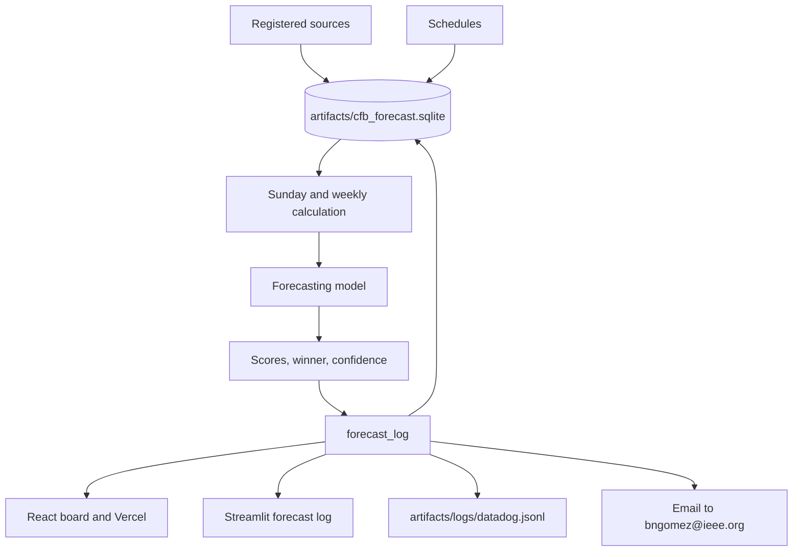
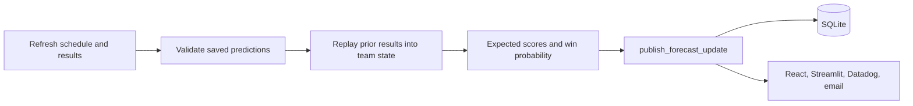
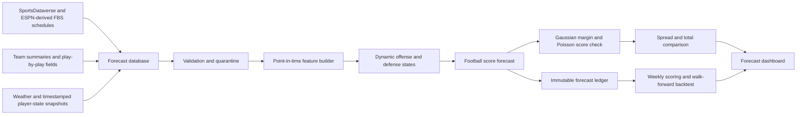

# FieldQuant FBS Forecast Desk

A real-data forecasting service for the 2026 FBS season. Each Sunday at 10 AM America/Chicago, it gathers game information, validates previously saved predictions, and calculates forecasts for the coming Monday–Sunday slate. Predictions, actual results, and hypothetical betting returns remain separate records.

## October 15 repository update

The [design implementation status](docs/design/IMPLEMENTATION_STATUS.md) maps the attached October 12 specification to executable code and the remaining estimation work. The original design and historical project records are retained under `docs/design/`.

The primary forecast now uses football inputs by default. Use `forecast --forecast-mode market_conditioned` for an explicitly separate calculation with market covariates. Both modes retain quotes for comparison and spread/total pricing. Published runs freeze full-precision predictions, numerical inputs, fitted parameters, state and source files; changing a saved run requires a new run ID. `evaluate-run` verifies those files and records later outcomes and errors separately. [Verification results](docs/verification/2026-10-15/README.md) describe this execution.

## Actual project configuration

| Field | Value |
| --- | --- |
| Project root | `/mnt/c/Users/brian/cfb-forecast` |
| Python virtual environment | `/home/brian/.venvs/cfb-forecast` |
| Windows environment | `C:\Users\brian\miniforge3\envs\cfb-python` |
| Python version | `3.12.3` |
| pip version | `26.2.1` |
| Package name | `cfb-forecast` |
| Package version | `0.4.0` |
| Python source | `/mnt/c/Users/brian/cfb-forecast/src/cfb_forecast` |
| Runtime data directory | `/mnt/c/Users/brian/cfb-forecast/data` |
| Runtime artifacts directory | `/mnt/c/Users/brian/cfb-forecast/artifacts` |
| Docker application directory | `/app` |
| Main Docker image | `cfb-forecast:local` |
| Dashboard Docker image | `cfb-forecast-dashboard:local` |
| Docker base image | `python:3.12-slim` |
| Compose service | `cfb-forecast` |
| Dashboard service | `cfb-dashboard` |
| Dashboard port | `8501` |
| Dashboard address | `http://localhost:8501` |
| Compose network | `cfb_forecast_default` |
| Forecast container UID | `10001` |
| Forecast container GID | `10001` |
| Test result | See the dated verification record above |

The editable install is the git checkout. On Linux that environment is `/home/brian/.venvs/cfb-forecast`. On Windows it is `C:\Users\brian\miniforge3\envs\cfb-python`.

## Architecture, pipelines, workflows, and sources

The [attachment import record](docs/design/README.md) retains the supplied source design, archive comparison and uploaded change history. The [current implementation status](docs/design/IMPLEMENTATION_STATUS.md) records the executable changes in this update.

Forecasts come from one model, with an explicit football-only or market-conditioned input mode. A hierarchical team state sets the score location. Pregame team and player rates from the parquet seasons on disk (2000 through 2025, plus completed games after that) and known-future information (market line, total, rest, weather, and reported injuries) shift that location together. The same location is the Gaussian mean and the Poisson rate. The win probability is the Gaussian probability that the home score exceeds the away score. Spread and total probabilities are analytic Gaussian probabilities. A missing rate stays missing. Every recorded game in the previous season sets that season's mean; every completed game in the current season updates it. Those rates are stored in `team_game_facts` and `player_game_facts`, and the next weekly forecast reads them back into the same hierarchical state, Poisson rates, Gaussian scores, and Gaussian win probability. The prediction board shows kickoff, teams, expected score, winner, and confidence. Spreads and moneylines, team and player statistics, and method notes are separate pages. Weather comes from the ESPN game summary, and from Open-Meteo for the venue when that summary has none. CollegeFootballData lines enter the forecast from the key in `pyproject.toml`. Weather, team stats, and player stats are collected from the same API. FootballDB college offense, defense, scoring, and player pages are collected with the other sources. cfbtrack.com supplies current team and player season stats. A saved model keeps the warmup season it was fit with. Missing history is left missing; it is not replaced with a made-up season.





| Workflow | What it runs |
| --- | --- |
| Sunday service | `python -m cfb_forecast sunday-run` at 10:00 America/Chicago. It validates the previous slate and writes the next one. |
| Weekly forecast | `run_weekly_forecast` calculates one week and publishes that board. |
| Publish update | `python -m cfb_forecast publish-update --run DIR --run-id ID` stores an existing calculation in SQLite, the apps, the Datadog log, and the email outbox. |
| Forecast database | Weekly and Sunday runs store every source in SQLite. The forecast reads that database. |
| Update database | `cfb-forecast update-database --season 2026` writes schedules into `games` and `game_teams` and every registered source into `source_rows`. |
| Data watchdog | `cfb-data-watchdog` records file checksums in `data_files` and `watchdog_events`. |
| Tests | `.github/workflows/tests.yml` installs the package and runs pytest. |
| Docker image | `.github/workflows/docker.yml` builds the local image. |
| External sources | `.github/workflows/external-sources.yml` collects the weekly public sources. |
| Sunday automation | `.github/workflows/sunday.yml` restores the runtime and runs the Sunday service. |

The SQLite file is `artifacts/cfb_forecast.sqlite`. `sql/schema.sql` is the schema applied on connect. The published board is `forecast_log`. Learning rows are `learning_versions` and `training_examples`. The forecast reads `team_game_facts`, `player_game_facts`, `team_play_rates`, and `source_rows`. Source provenance is `source_registry` and `source_retrievals`.

Datadog reads `artifacts/logs/datadog.jsonl` through `deploy/datadog/conf.yaml`. Intake runs only when `DD_API_KEY` is set. Email is sent only when `CFB_SMTP_HOST` and `CFB_SMTP_PASSWORD` are set.

| Source | URL |
| --- | --- |
| cfbfastR | `https://cfbfastr.sportsdataverse.org/` |
| cfbfastR models | `https://github.com/sportsdataverse/cfbfastR-cfb-data/blob/main/models/REGISTRY.md` |
| SportsDataverse | `https://github.com/sportsdataverse/sportsdataverse-data` |
| radsportsanalytics | `https://radsportsanalytics.com/blog/introduction-to-cfb-analytics/` |
| cfbtrack | `https://cfbtrack.com/` |
| cfbtracker | `https://cfbtracker.com/` |
| cfbresults | `https://cfbresults.com/` |
| college-football-results | `https://college-football-results.com/` |
| collegefootballdb | `https://collegefootballdb.com/` |
| cfbstats | `https://cfbstats.com/` |
| collegefootballdata | `https://collegefootballdata.com/` |
| mrtimo schedule | `https://mrtimo.github.io/cfb-games/games-{season}.html` |
| CollegeFootballData key | `https://collegefootballdata.com/key` |
| CollegeFootballData ratings | `https://api.collegefootballdata.com/ratings/core` |
| cfbtxt validation | `https://cfbtxt.com/schedule/` |
| FanDuel comparison | `https://www.fanduel.com/research/ncaaf` |
| FootballDB team stats | `https://www.footballdb.com/college-football/stats/teamstat.html?yr={season}&lg=FBS` |
| FootballDB stats index | `https://www.footballdb.com/college-football/stats/index.html` |
| FootballDB player stats | `https://www.footballdb.com/college-football/stats/stats.html?lg=FBS&yr={season}` |
| Open-Meteo | `https://api.open-meteo.com/v1/forecast` |
| ESPN scoreboard | `https://site.api.espn.com/apis/site/v2/sports/football/college-football/scoreboard` |

The exact runtime data snapshots the pipeline downloads — schedules and advanced team summaries for 2021–2026 — are recorded with their URLs, byte sizes, and SHA-256 checksums in [`docs/data-sources.json`](docs/data-sources.json). The `data/` directory itself stays out of source control; that file is the tracked provenance record for it.

## Run with the established Linux environment

From Ubuntu WSL:

```bash
cd /mnt/c/Users/brian/cfb-forecast
source /home/brian/.venvs/cfb-forecast/bin/activate
```

Verify the active interpreter:

```bash
command -v python
python --version
python -m pip --version
```

Expected values:

```text
/home/brian/.venvs/cfb-forecast/bin/python
Python 3.12.3
pip 26.2.1
```

Install the project into the established environment:

```bash
python -m pip install -r requirements-tested.txt
python -m pip install -e '.[test]'
```

Run the forecasting service:

```bash
OPENBLAS_NUM_THREADS=1 \
OMP_NUM_THREADS=1 \
python -m cfb_forecast sunday-run --season 2026
```

Run the dashboard directly from Linux:

```bash
CFB_ARTIFACTS_DIR=runtime/artifacts streamlit run dashboard/app.py
```

The dashboard is available at:

```text
http://localhost:8501
```

## Alternative runtime paths

The project can use separate runtime directories while preserving the same source tree:

```bash
python -m cfb_forecast sunday-run \
  --season 2026 \
  --data runtime/data \
  --artifacts runtime/artifacts
```

Run the dashboard against custom artifacts:

```bash
CFB_ARTIFACTS_DIR=runtime/artifacts streamlit run dashboard/app.py
```

The first run downloads real SportsDataverse schedules and advanced team summaries for 2021–2026, trains models from earlier seasons, measures historical performance, and generates the live slate.

Later runs reuse historical inputs and trained models while refreshing the current season.

No sample data or canned performance numbers are included in the application. Downloaded data, trained models, and generated reports are runtime files excluded from source control.

The service preserves one completed forecast per slate. Running it twice does not overwrite earlier predictions. A failed run remains under:

```text
artifacts/work/
```

A failed run can be retried. Operating-system locking prevents concurrent writers and releases automatically if the process exits.

## Calculation order

1. Refresh the season schedule, advanced statistics, and authoritative final results.
2. Verify game IDs and team IDs.
3. Reject future final outcomes.
4. Select upcoming FBS-versus-FBS games in the coming calendar week.
5. Exclude FBS–FCS games from predictions and evaluation.
6. Retrieve weather, injuries, depth charts, rosters, player leaders, team statistics, and available sportsbook quotes.
7. Preserve response bytes, source URLs, retrieval times, and checksums before inference.
8. Validate previously saved predictions against completed results.
9. Score probability quality, winner accuracy, score errors, and hypothetical returns.
10. Use the prices recorded when predictions were issued.
11. Keep pending games pending.
12. Build game features.
13. Fit context candidates using earlier saved game inputs and later real results.
14. Reserve the latest prior week for model comparison before adoption.
15. Replay eligible prior FBS results into opponent-adjusted team states.
16. Calculate score expectations and winner, cover, and total probabilities directly from the fitted distribution.
17. Do not generate simulated score samples in the live workflow.
18. Apply the selected probability model and any validated context contribution.
19. Compare probabilities with the actual recorded prices.
20. Enforce decision and exposure limits.
21. Save the completed run.

## Data coverage and sources

### SportsDataverse

SportsDataverse supplies:

- Game schedules.
- Final scores.
- Per-game advanced team statistics.

Historical records can contain later corrections. Historical results therefore do not reconstruct every original publication timestamp.

### ESPN public endpoints

ESPN public endpoints supply, when available:

- Live final scores.
- Upcoming-game weather.
- Player leaders.
- Season team statistics.
- Rosters.
- Injury information.
- Depth-chart information.
- Currently displayed sportsbook prices.

The retrieval time is treated as the quote availability time.

Missing fields remain missing. The system does not invent a price, injury probability, lineup state, weather value, or player replacement value.

### Football Database and CFBTrack

The service queries the following sources for college team and player-stat tables:

```text
https://www.footballdb.com
cfbtrack.com
```

Verified-season tables enter the feature stage through:

- Explicit CFBTrack team IDs.
- Exact roster player names.

Football Database passing fields preserve their original source names. The most-used passer is identified by recorded attempts rather than assuming the confirmed starter.

Independent sources remain separate when their values differ.

Access failures and missing tables appear in the Sources view.

This address is not treated as equivalent:

```text
footbaldb.com
```

It is different from:

```text
https://www.footballdb.com
```

The system does not treat the addresses as equivalent unless an actual redirect confirms the relationship.

A roster or active-player flag does not confirm a starting lineup.

An empty injury response means that coverage is unavailable. It does not mean that every player is healthy.

Context fields are collected first and retained as calculation inputs.

Numeric weather, player statistics, team statistics, and reported injuries enter the context model only when:

- Enough recorded pregame examples have actual outcomes.
- The candidate improves validation log loss.
- The candidate does not worsen Brier score.
- The missingness indicators are retained.
- The latest prior week remains reserved for comparison.

Before that evidence exists, the base model remains active and the report explains why.

The system does not invent:

- Weather penalties.
- Player replacement values.
- Questionable-player probabilities.
- Injury probabilities.
- Starting-lineup assumptions.
- Missing sportsbook prices.
- Synthetic game results.

## Models and measured development

The engine fits dynamic Gaussian offense and defense states from prior FBS games.

The score-only and PBP score heads use standardized regularized regression.

The PBP head includes offense and defense interactions.

A separate time-decayed ridge strength model implements opponent-adjusted margin ratings with:

```text
Half-life: 365 days
Ridge penalty: 8 games
Non-neutral venue adjustment: 3 points
```

Its logistic probability regularization is selected using the earlier validation season.

Default historical training uses:

```text
Warmup season: 2021
Initial fitting seasons: 2022–2023
Settings and probability calibration: 2024
Model comparison: 2025
Prediction season: 2026
```

Models are subsequently refitted through 2025 for 2026 predictions.

The Sunday initializer compares the strength model with the selected score head on 2025 data to choose the 2026 winner model.

Because the 2025 comparison guides the deployment choice, 2025 is not an untouched evaluation of that final deployment choice.

Scores and winner probabilities may come from separate heads. The exported `probability_source` identifies the head used.

## Context learning

Context learning uses saved pregame:

- Weather.
- Player statistics.
- Team statistics.
- Reported availability evidence.
- Missingness indicators.

The maximum logit adjustment is bounded.

A context candidate requires at least:

```text
Three recorded weeks
150 settled games
```

The latest prior week remains reserved for comparison.

Outcome columns and betting prices cannot enter context features.

## Probability audit

Evaluate constrained probability fine-tuning and adversarial sensitivity using actual exported predictions:

```bash
python -m cfb_forecast probability-audit \
  --input my_actual_predictions.csv \
  --probability-column score_p \
  --outcome-column home_win \
  --max-change 0.05 \
  --stress-radius 0.1 \
  --out artifacts/probability-research
```

The CSV requires:

```text
game_id
season
The named probability column
The named outcome column
as_of and kickoff
or forecast_cutoff and start_date
```

The required fields are:

- `game_id` must be unique.
- `season` must be an integer.
- Probabilities must come from earlier-trained models.
- Outcome values must be available for evaluation.
- Time fields must identify the prediction information set.

Each evaluation season receives calibration fitted only on prior seasons.

**2. Expected points.** A regression turns the two teams' ratings into expected points for each side. The learning stage proposes refits with recent games counting more. It fits the candidate without the latest held-out games and checks its log loss on them: if the candidate is no worse than the current regression on those games, the status is `promoted` and the candidate takes over; otherwise the status is `retained` and the current regression stays in use. Forecasting uses whichever regression is selected; the Bayesian team ratings still update as results arrive.
A single-season file produces a candidate for later use but cannot demonstrate later-season improvement.

The constraint bounds changes on:

- Clean fitting probabilities.
- A dense probability grid.

Stress testing maximizes loss within a coefficient-norm radius to measure local sensitivity.

Stress testing does not:

- Modify the deployed model.
- Hide model activity.
- Replace the production calibration.
- Convert research output into a deployed model automatically.

The uploaded adversarial document contains an MLP research outline, not an executable implementation.

The production head is not an MLP. The experiment operates on actual probability-calibration coefficients.

Published numbers from the uploaded methodology are not copied into application results.

## Betting decisions

Moneyline prices are converted to decimal odds.

A two-sided no-vig probability is then computed.

Edge and expected return are separate calculations.

A separate team strength model (opponent-adjusted margins, with a 365-day half-life, an 8-game ridge penalty and a 3-point home edge) is fitted alongside and kept for comparison. Win chances always come from the forecasting model described above, read off the fitted logistic curve from the score margin; the strength model never sets a win chance.
A hypothetical candidate requires:

- At least two percentage points of edge.
- Positive expected net return at the offered price.
- Complete weather coverage.
- Complete injury coverage.
- Complete lineup coverage.
- Complete player-input coverage.
- Complete team-input coverage.

Quarter-Kelly exposure is capped at:

```text
1% per game
5% per slate
```

These are explicit operating settings. They are not evidence of profitability.

Spread and total probabilities use the score distribution with continuity corrections for integer pushes.

Validation uses the candidate and quote saved with the prediction.

Missing odds produce no ROI claim.

Reported unit returns are hypothetical. The application does not place bets.

Sunday prices can change materially before kickoff.

Unknown lineups or missing injury coverage suppress recommendations.

## Sunday automation

The workflow file is:

```text
.github/workflows/sunday.yml
```

It runs at:

```text
15:00 UTC on Sundays
16:00 UTC on Sundays
```

The application executes only during:

```text
10:00 AM America/Chicago
```

This handles daylight-saving changes and duplicate workflow runs.

GitHub can delay scheduled jobs.

The workflow saves:

- Downloaded sources.
- Trained models.
- Prior predictions.
- Validation reports.
- Runtime artifacts.

The next run restores the newest available artifact.

Forecast and validation reports are downloadable separately.

Runtime artifacts expire after:

```text
90 days
```

Export artifacts if the service is paused longer than 90 days.

GitHub schedules become active when:

- The workflow exists on the repository's default branch.
- GitHub Actions is enabled.
- The workflow has valid permissions.
- The repository is available to the runner.

Manual dispatch runs immediately, including the initial setup run.

## Outputs

| Path | Content |
| --- | --- |
| `artifacts/runs/<season-date>/forecasts.csv` | Pregame predictions, prices, model contributions, context contributions, and decision status |
| `artifacts/runs/<season-date>/inputs/` | Raw responses, receipts, game inputs, and feature values |
| `artifacts/runs/<season-date>/run_manifest.json` | Run timing, source checksums, model checksums, prediction checksum, and selection evidence |
| `artifacts/runs/<season-date>/validation.csv` | Later actual finals joined to unchanged predictions |
| `artifacts/runs/<season-date>/validation.json` | Probability, score, and saved-price betting metrics |
| `artifacts/latest/` | Most recent completed run for the dashboard |
| `artifacts/training/` | Recomputed historical comparisons and fitted model files |
| `web/public/forecasts.json` | Board the React app and the Vercel build serve |
| `artifacts/cfb_forecast.sqlite` | Source catalog and `forecast_log` rows |

A completed Sunday or weekly run calls `publish_forecast_update`. The same board is written to SQLite, `artifacts/latest/forecast_board.json`, the React file, the Streamlit forecast log, `artifacts/logs/datadog.jsonl`, and an email to `bngomez@ieee.org`. Email is sent only when `CFB_SMTP_HOST` and `CFB_SMTP_PASSWORD` are set. Datadog intake is used only when `DD_API_KEY` is set. Otherwise both receipts stay on disk.

Publish an existing calculation without retraining:

```bash
python -m cfb_forecast publish-update --run artifacts/weekly/2026-week-7 --run-id 2026-week-7 --fetch-sources
```

## Verification

Run the complete test suite:

```bash
cd /mnt/c/Users/brian/cfb-forecast
source /home/brian/.venvs/cfb-forecast/bin/activate
python -m pytest -q
```

Actual verified result:

```text
39 passed
```

Verify the command-line interface:

```bash
python -m cfb_forecast --help
```

The installed console command is:

```bash
cfb-forecast
```

The project has been installed editable into:

```text
/home/brian/.venvs/cfb-forecast
```

Tests use small explicit fixtures to check:

- Timing.
- Model isolation.
- Source archives.
- Pricing arithmetic.
- Calibration constraints.
- Context leakage.
- Prediction integrity.

Fixtures are not imported by production.

Source and network failures fail required ingestion or appear as unavailable optional context. They do not trigger sample-data generation.

## Docker configuration

The built Docker images are:

```text
cfb-forecast:local
cfb-forecast-dashboard:local
```

The Docker base image is:

```text
python:3.12-slim
```

The forecast container installs the package into `/app`.

The forecast container runs as:

```text
UID 10001
GID 10001
```

The dashboard exposes:

```text
8501
```

The dashboard URL is:

```text
http://localhost:8501
```

The Docker build was completed successfully for:

```text
cfb-forecast:local
cfb-forecast-dashboard:local
```

The forecast image responds to:

```bash
cfb-forecast --help
```

The dashboard image contains:

```text
streamlit 1.65.0
```

Docker Desktop is reachable from Ubuntu through:

```text
docker.exe
```

The standard Linux `docker` command is not currently available directly inside the Ubuntu WSL distribution.

## Docker Compose

The Compose services are:

```text
cfb-forecast
cfb-dashboard
```

The Compose network is:

```text
cfb_forecast_default
```

The default bind mounts are:

```text
/mnt/c/Users/brian/cfb-forecast/data:/app/data
/mnt/c/Users/brian/cfb-forecast/artifacts:/app/artifacts
```

The dashboard mounts those directories read-only.

The forecast service mounts them read-write so it can produce runtime files.

For Docker Desktop bind mounts, the project directory must be shared with Docker Desktop:

```text
C:\Users\brian\cfb-forecast
```

The Docker Desktop file-sharing setting must allow access to:

```text
C:\Users\brian\cfb-forecast\data
C:\Users\brian\cfb-forecast\artifacts
```

Build both services:

```bash
docker compose build
```

When Docker Desktop is accessed from Ubuntu WSL through the available Windows-integrated CLI:

```bash
docker.exe compose build
```

Run the forecast job:

```bash
docker compose run --rm cfb-forecast sunday-run --season 2026
```

Run the dashboard:

```bash
docker compose up cfb-dashboard
```

For Compose startup with image refresh:

```bash
docker compose up --pull always
```

The dashboard should then be available at:

```text
http://localhost:8501
```

## Weekly controls and backtesting contract

The application is organized around a weekly Sunday pregame run.

The selected week is forecast from:

- The prior season.
- Eligible completed games from the selected season.
- Information available before the game-specific cutoff.

The default control is the earlier of:

```text
09:00 local venue time on Sunday
24 hours before kickoff
```

A forecast cannot consume:

- Its own final score.
- A later market quote.
- A later player report.
- A later weather report.
- A later injury report.
- A later lineup report.

### Weekly controls

The weekly controls are:

- Season.
- Week.
- Pregame cutoff.
- Training seasons.
- Market timestamp.
- Result availability.
- Data-audit status.

#### Season and week

Controls the FBS schedule slice shown to the user.

#### Pregame cutoff

Freezes the information set used for every game on the slate.

#### Training seasons

Uses the prior season and eligible completed games from the selected season.

#### Market timestamp

Only spreads and totals observed before the cutoff are eligible.

Missing prices remain missing.

#### Result availability

Only final scores with an availability timestamp before the cutoff update team states.

#### Data audit

The system quarantines rather than repairs:

- Duplicate game IDs.
- Invalid scores.
- Non-FBS matchups.
- Incomplete records.
- Unverifiable team IDs.
- Unverifiable game IDs.

The system does not repair quarantined data with invented values.

## Point-in-time backtesting contract

Each prediction is one immutable game-level row containing:

```text
game_id
kickoff_utc
cutoff_utc
home_team_id
away_team_id
pregame feature state
observed spread
spread observation timestamp
prediction
final outcome
```

The required leakage checks are:

```text
cutoff_utc < kickoff_utc
```

No training result may satisfy:

```text
result_available_at >= cutoff_utc
```

No market observation may satisfy:

```text
observed_at > cutoff_utc
```

The evaluation reports:

- Winner log loss.
- Winner Brier score.
- Margin MAE.
- Spread cover accuracy.
- Spread MAE.
- Calibration by probability bin.
- Sample counts.

These metrics remain separate from betting decisions.

A spread comparison is reported only when a real spread and price were captured.

The data layer does not include:

- Backfilled lines.
- Fabricated player states.
- Synthetic schedules.
- Simulated records.
- Invented injury probabilities.
- Invented weather values.
- Invented sportsbook prices.

## System architecture



The verified production implementation is Python-based.

No TypeScript implementation is included in the verified consolidated project root.

The Python package remains the reproducible research and training implementation.

The dashboard is a Streamlit application using the generated runtime artifacts and data.

## Complete Docker workflow

From the project root:

```bash
cd /mnt/c/Users/brian/cfb-forecast
```

Create runtime directories if they do not exist:

```bash
mkdir -p data artifacts
```

Build the images:

```bash
docker compose build
```

Run the forecast:

```bash
docker compose run --rm cfb-forecast sunday-run --season 2026
```

Start the dashboard:

```bash
docker compose up cfb-dashboard
```

With Docker Desktop accessed from Ubuntu through the integrated CLI:

```bash
docker.exe compose build
docker.exe compose run --rm cfb-forecast sunday-run --season 2026
docker.exe compose up cfb-dashboard
```

The dashboard will be available at:

```text
http://localhost:8501
```

Data and artifacts are excluded from the Docker build context and supplied through runtime mounts.

The single source project root is:

```text
/mnt/c/Users/brian/cfb-forecast
```

The single CFB Python environment is:

```text
/home/brian/.venvs/cfb-forecast
```
