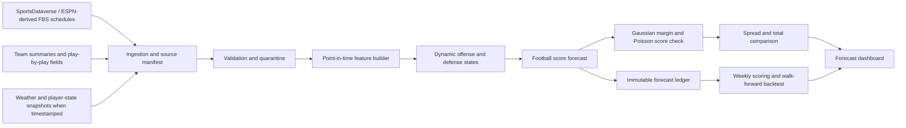

# FieldQuant FBS Forecast Desk

A real-data forecasting service for the 2026 FBS season. Each Sunday at 10 AM America/Chicago it gathers game information, validates the previous saved predictions, and calculates forecasts for the coming Monday–Sunday slate. Predictions, actual results, and hypothetical betting returns are separate records.

## Run

Use Python 3.11+ on Linux, macOS, or the supplied Docker image:

```bash
python -m pip install -e '.[test]'
OPENBLAS_NUM_THREADS=1 OMP_NUM_THREADS=1 python -m cfb_forecast sunday-run --season 2026
python -m pip install -r dashboard/requirements.txt
streamlit run dashboard/app.py
```

The first run downloads real SportsDataverse schedules and advanced team summaries for 2021–2026, trains models from the earlier seasons, measures historical performance, then generates the live slate. Later runs reuse the historical inputs and trained model while refreshing the current season. No sample data or canned performance numbers ship with the application. Downloaded data, trained models, and generated reports are runtime files excluded from source control.

Alternative paths:

```bash
python -m cfb_forecast sunday-run --season 2026 --data runtime/data --artifacts runtime/artifacts
CFB_ARTIFACTS_DIR=runtime/artifacts streamlit run dashboard/app.py
```

The service preserves one completed forecast per slate. Running it twice does not overwrite earlier predictions. A failed run remains under `artifacts/work/`; it can be retried. Operating-system locking prevents concurrent writers and releases automatically if the process exits.

## Calculation order

1. Refresh the season schedule, advanced statistics, and authoritative final results. Verify game and team IDs; reject future final outcomes.
2. Select upcoming FBS-versus-FBS games in the coming calendar week. FBS–FCS games are excluded from predictions and evaluation.
3. Retrieve weather, injuries, depth charts, rosters, player leaders, team statistics, and actual sportsbook quotes. Preserve response bytes, source URLs, retrieval times, and checksums before inference.
4. Validate previously saved predictions using completed results. Score probability quality, winner accuracy, score errors, and returns at the prices recorded when predictions were issued. Pending games remain pending.
5. Build game features. Fit any context candidate using earlier saved game inputs and their later real results. Reserve the latest prior week for model comparison before adoption.
6. Replay eligible past FBS results into opponent-adjusted team states. Calculate score expectations and winner/cover/total probabilities directly from the fitted distribution; the live workflow does not generate simulated score samples.
7. Apply the selected probability model and any validated context contribution. Compare probability with the actual recorded prices, enforce decision/exposure limits, and save the run.

## Data coverage and sources

- **SportsDataverse** supplies game schedules, final scores, and per-game advanced team statistics. Historical records can contain later corrections; measured historical results do not reconstruct all original publication dates.
- **ESPN public endpoints** supply live finals, upcoming-game weather, player leaders, season team statistics, rosters, injury/depth-chart information when provided, and current displayed sportsbook prices. Retrieval time is the quote availability time. Missing fields are never filled with an invented price or an injury probability.
- **Football Database** (`www.footballdb.com`) and **CFBTrack** (`cfbtrack.com`) are queried for college team/player-stat tables. Verified-season tables enter the feature stage through explicit CFBTrack team IDs or exact roster player names. Football Database passing fields retain their own source names, and the most-used passer is identified by recorded attempts rather than assumed to be the confirmed starter. Independent sources are retained separately when their values differ. Access failures and missing tables appear in the desk's Sources view. `footbaldb.com` is a different address and is not treated as equivalent without a redirect.

A roster or an active-player flag is not a confirmed starting lineup. An empty injury response means coverage is unavailable, not that everyone is healthy. Context fields are collected first and retained as calculation inputs. Numeric weather, player/team statistics, and reported injuries enter the context model once enough recorded pregame examples have actual outcomes and the candidate improves validation log loss without worsening Brier score. Before that evidence exists, the base model remains active and the report states why. No weather penalty, player replacement value, or questionable-player probability is invented.

## Models and measured development

The engine fits dynamic Gaussian offense/defense states from prior FBS games. Score-only and PBP score heads use standardized regularized regression; the PBP head includes offense/defense interactions. A separate time-decayed ridge strength model implements opponent-adjusted margin ratings with a 365-day half-life, an eight-game ridge penalty, and a three-point non-neutral venue adjustment. Its logistic probability regularization is selected using the earlier validation season.

Default historical training uses 2021 as warmup, 2022–2023 for initial fitting, 2024 for settings and probability calibration, and 2025 for comparison. Models are subsequently refitted through 2025 for 2026 predictions. The Sunday initializer compares strength with the selected score head on 2025 to choose the 2026 winner model. Because that comparison guides deployment, 2025 is not an untouched evaluation of that deployment choice. Scores and winner probability may come from separate heads; the exported `probability_source` identifies which one is used.

Context learning uses saved pregame weather, player/team statistics, and reported availability evidence with learned missingness indicators. Its maximum logit adjustment is bounded. At least three recorded weeks and 150 settled games are required for selection; the latest prior week is reserved for comparison. Outcome columns and betting prices cannot enter context features.

Evaluate constrained probability fine-tuning and adversarial sensitivity on actual exported predictions:

```bash
python -m cfb_forecast probability-audit \
  --input my_actual_predictions.csv \
  --probability-column score_p --outcome-column home_win \
  --max-change 0.05 --stress-radius 0.1 \
  --out artifacts/probability-research
```

The CSV needs unique `game_id`, integer `season`, the named probability/outcome columns, and `as_of`/`kickoff` or `forecast_cutoff`/`start_date`. Its probabilities must themselves come from earlier-trained models. Each evaluation season receives calibration fitted only on prior seasons. A single-season file produces a candidate for later use but cannot demonstrate later-season improvement. The constraint bounds changes on the clean fitting probabilities and a dense probability grid. Stress testing maximizes loss within a coefficient-norm radius to measure local sensitivity; it never modifies the deployed model or hides its activity.

The uploaded adversarial document contains an MLP research outline, not an executable implementation. This repository's production head is not an MLP, so the experiment operates on the actual probability-calibration coefficients. The uploaded methodology's published numbers are not copied into this application's results.

## Betting decisions

Moneyline prices are converted to decimal odds, then a two-sided no-vig probability is computed. Edge and expected return are separate calculations. A hypothetical candidate requires an edge of at least two percentage points, positive expected net return at the offered price, and complete weather/injury/lineup/player/team input coverage. Quarter-Kelly exposure is capped at 1% per game and 5% per slate. These are explicit operating settings, not evidence of profitability. Spread/total probabilities use the score distribution with continuity corrections for integer pushes.

Validation uses the candidate and quote actually saved with a prediction. Missing odds yield no ROI claim. Reported unit returns are hypothetical; the application does not place bets. Sunday prices can change materially before kickoff, and unknown lineups or missing injury coverage suppress recommendations.

## Sunday automation

`.github/workflows/sunday.yml` runs at 15:00 and 16:00 UTC on Sundays. The application executes only during 10 AM America/Chicago, handling daylight saving time and duplicate runs. GitHub can delay scheduled jobs. The workflow saves downloaded sources, trained models, prior predictions, and validation reports in a runtime artifact, then restores the newest available artifact on the next run. Forecast and validation reports are downloadable separately. Runtime artifacts expire after 90 days, so export them if the service is paused longer than that.

GitHub schedules become active when the workflow exists on the repository's default branch and Actions is enabled. Manual dispatch runs immediately, including the initial setup run.

## Outputs

| Path | Content |
| --- | --- |
| `artifacts/runs/<season-date>/forecasts.csv` | Saved pregame predictions, prices, model/context contributions, and decision status |
| `artifacts/runs/<season-date>/inputs/` | Actual raw responses, receipts, game inputs, and feature values |
| `artifacts/runs/<season-date>/run_manifest.json` | Run timing, source/model checksums, prediction checksum, and selection evidence |
| `artifacts/runs/<season-date>/validation.csv` | Later actual finals joined to that run's unchanged predictions |
| `artifacts/runs/<season-date>/validation.json` | Probability, score, and saved-price betting metrics |
| `artifacts/latest/` | Most recent completed run for the dashboard |
| `artifacts/training/` | Recomputed historical comparisons and fitted model files |

## Verify

```bash
python -m pytest -q
python -m cfb_forecast --help
```

Tests use small explicit fixtures to check timing, model isolation, source archives, pricing arithmetic, calibration constraints, context leakage, and prediction integrity. Those fixtures are never imported by production. Source/network failures fail required ingestion or appear as unavailable optional context; they never trigger sample data generation.

For Docker Compose with Linux bind mounts, match the forecasting container to the host user so it can write runtime files:

## Weekly controls and backtesting contract

The application is organized around a weekly Sunday pregame run. The selected week is forecast from the prior season and all current-season games whose final result was available before the forecast cutoff. The default control is the earlier of 09:00 local venue time on Sunday or 24 hours before kickoff. A forecast is never allowed to consume its own final score, a later market quote, or a later player/weather report.

### Weekly controls

- **Season and week:** controls the FBS schedule slice shown to the user.
- **Pregame cutoff:** freezes the information set used by every game on the slate.
- **Training seasons:** prior season plus eligible completed games from the selected season.
- **Market timestamp:** only spreads and totals observed before the cutoff are eligible; missing prices remain missing.
- **Result availability:** only final scores with an availability timestamp before the cutoff update team states.
- **Data audit:** duplicate game IDs, invalid scores, non-FBS matchups, and incomplete records are quarantined rather than repaired with invented values.

### Point-in-time backtesting contract

Each prediction is one immutable row at game level: `game_id`, `kickoff_utc`, `cutoff_utc`, home/away team IDs, the pregame feature state, the observed spread and timestamp when available, the prediction, and the final outcome. The required leakage checks are `cutoff_utc < kickoff_utc`, no training result has `result_available_at >= cutoff_utc`, and no market observation has `observed_at > cutoff_utc`.

The evaluation reports winner log loss and Brier score, plus margin MAE, spread cover accuracy, spread MAE, calibration by probability bin, and sample counts. These are separate from betting decisions: a spread comparison is reported only when a real spread and price were captured. There is no backfilled line, fabricated player state, synthetic schedule, or simulated record in the data layer.

### System architecture



The TypeScript preview uses the same contracts through `lib/forecast-engine.ts` and `app/api/forecast/route.ts`. The Python package remains the reproducible research and training implementation; the web route is an honest live-data adapter, not a replacement for the historical package or a source of simulated values.

```bash
mkdir -p data artifacts
export CFB_UID=$(id -u) CFB_GID=$(id -g)
docker compose build
docker compose run --rm cfb-forecast sunday-run --season 2026
docker compose up cfb-dashboard
```

Data and artifacts are excluded from the Docker build context and supplied through runtime mounts.
