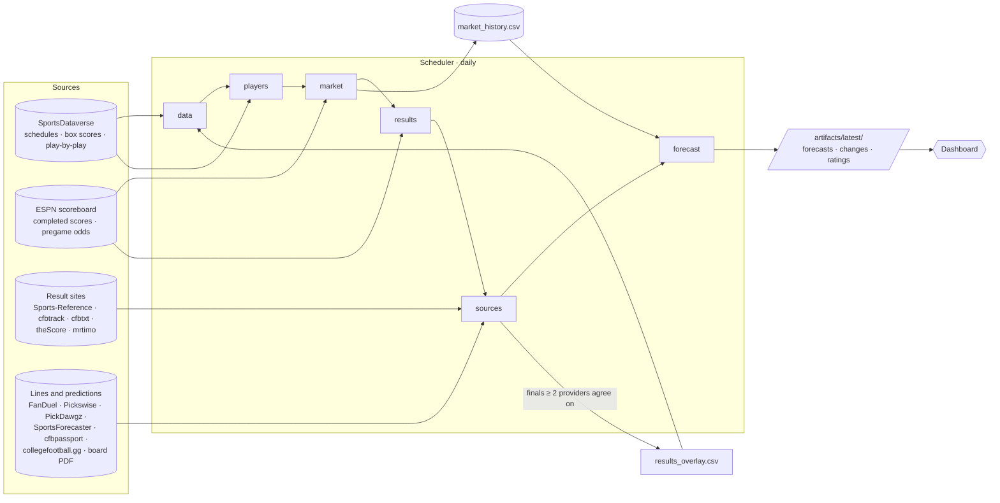
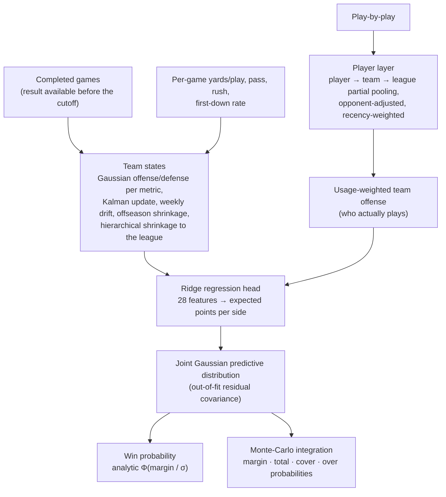
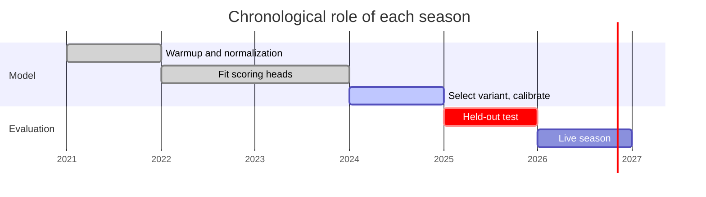

# CFB Forecast

An application that forecasts every FBS college football game, every day. It keeps itself current: it pulls the schedule, completed results, play-by-play and market lines, re-estimates team and player strength, and publishes a win probability and full score distribution for every game still to be played, with a dashboard on top.

```bash
docker compose up -d        # scheduler + dashboard; open http://localhost:8501
# or, without Docker:
pip install -e ".[dashboard]" && cfb-forecast app
```

The first start produces forecasts on its own; after that a new forecast is published every day, with a table of what moved since the previous run.

| | |
|---|---|
| **Output** | Home win probability, expected scores, margin and total distributions with 80% intervals, cover/over probabilities when a line exists |
| **Method** | Gaussian state-space model (Kalman filter) with Bayesian hierarchical pooling, a hierarchical player layer from play-by-play, ridge regression, and Monte-Carlo integration for the predictive distribution |
| **Guarantee** | Every forecast is built only from results that were available before its cutoff, and records its source and model hashes |
| **2025 held-out** | 72.5% winners, log loss 0.5395, Brier 0.1826 over 808 FBS games; calibrated Elo scores 0.575 ([details](docs/RESULTS.md)) |

Forecasts are research outputs. The evaluation found no betting edge.

---

## What the application does



Each daily run, in order:

| Stage | What it does | If it fails |
|---|---|---|
| `data` | Downloads or refreshes the season's schedule and advanced box scores; keeps the cached copy if the source is down | Stops the run (required) |
| `preflight` | Checks the data folders and the production model | Stops the run (required) |
| `players` | Aggregates the season's play-by-play into compact per-player-game files | Run continues (optional) |
| `market` | Captures ESPN pregame odds (spread, total, moneylines) and the SportsDataverse line snapshot, each stamped with the time it was seen | Run continues; fails only if both captures fail |
| `results` | Pulls final scores of completed games from the ESPN scoreboard | Run continues |
| `sources` | Collects the external sites (below) and cross-checks their final scores | Run continues |
| `forecast` | Forecasts every remaining upcoming FBS game, writes the changes and ratings tables, prunes old snapshots | Stops the run (required) |
| `verify` | Confirms the outputs exist | Stops the run (required) |

An optional-stage failure is logged and the run finishes as `degraded`; a required-stage failure ends it with a nonzero exit code. Every run writes a receipt to `artifacts/pipeline/` and a log to `artifacts/logs/`.

### Automation

The scheduler (`cfb-forecast scheduler`, or the `scheduler` container) reads the season's kickoff times from the schedule and runs:

| Job | When (UTC) | Runs |
|---|---|---|
| `forecast` | Daily at 09:00, and at once on a fresh start, while a game is within 21 days of today | The daily pipeline above |
| `backtest` | Tuesday 11:00 in season | Point-in-time backtest of every completed week of the season against the final scores |

Outside the season nothing is due, so the application idles and resumes when the next schedule appears. State, a heartbeat for the container health check and a single-instance lock live in `artifacts/scheduler/`. `cfb-forecast scheduler --status` shows what is due; `--once` runs what is due and exits, for cron or Task Scheduler.

### What a run publishes

`artifacts/latest/` (and a dated copy in `artifacts/forecasts/<UTC stamp>/`, the newest 14 kept):

| File | Contents |
|---|---|
| `forecasts.csv` / `.json` | Per game: win probability, expected scores, margin and total, 80% intervals, simulated and analytic probabilities, cover/over probabilities where a line exists |
| `score_distribution.parquet` · `margin_…` · `total_…` | Full discrete probability tables per game |
| `changes.csv` | Change in win probability, margin and total since the previous run, biggest movers first |
| `team_ratings.csv` | Pass, rush, offense, defense and net rating per team |
| `player_ratings.csv` | Named passer and runner ratings with usage share and recent plays |
| `forecast_manifest.json` · `data_availability.json` | Cutoff, every game used, source and model hashes, what data existed at the cutoff |

### Dashboard

`http://localhost:8501`, four views: **Current forecast** (filterable game table, win-probability and score charts, what changed since the last run); **Players & teams** (team ratings, searchable player ratings); **Historical backtest** (any past forecast run graded against actual results); **External sources** (status of every site, score conflicts, outside predictions for upcoming games).

## The model

One model produces the predictive probability. Its parts are standard methods, applied in sequence:



- **Team states** (`ratings.py`): for each of five metrics (points, yards/play, yards/pass, yards/rush, first-down rate) every team has a Gaussian offense and defense state with full covariance. A game updates the home and away states jointly through the Kalman filter; states drift each week and are shrunk toward the league each offseason. Shared zero-centred priors give partial pooling.
- **Player layer** (`players.py`): per-play rush and pass yardage is modelled as `y = player + defense + error`, with players pooled toward their team and teams toward the league, solved by conjugate Gaussian shrinkage iterated between the offense and defense blocks. Plays are weighted by recency (8-week half-life), so the rating tracks current form. A team's rating averages its players weighted by recent usage, so a star who has stopped playing stops counting.
- **Points head** (`model.py`): a standardized ridge regression maps the 26 state features plus the two player features (own player offense, opponent player defense) to expected points for each side, fitted on earlier seasons only.
- **Predictive distribution** (`simulate.py`): the 2024 out-of-fit residual covariance gives a joint Gaussian for the two scores. Win probability is its analytic margin integral; margin, total, cover and over probabilities are Monte-Carlo integrals of the same distribution.
- **Market lines** are never an input to the win probability. They are stamped with when they were seen and used only for cover, over/under and expected-return diagnostics.

Equations, information-cutoff rules and limits are in [docs/METHODOLOGY.md](docs/METHODOLOGY.md). A result is usable only if it became available strictly before the forecast cutoff (kickoff + 8 hours when the real completion time is unknown); the player layer follows the same rule.



### Results

2025 held-out season, 808 FBS-vs-FBS games, heads fitted through 2024 (`artifacts/backtest/metrics.csv`):

| Model | Winner accuracy | Log loss | Brier | Margin MAE | Total MAE |
|---|---:|---:|---:|---:|---:|
| Calibrated Elo | 69.55% | 0.5750 | 0.1965 | — | — |
| Team states, score only | 72.03% | **0.5377** | **0.1814** | 12.50 | 12.98 |
| Team states + play-by-play | **73.02%** | 0.5406 | 0.1830 | 12.41 | 12.99 |
| **+ player layer (selected)** | 72.52% | 0.5395 | 0.1826 | **12.41** | **12.97** |

The paired block-bootstrap tests (score and play-by-play models against Elo) exclude zero; the player variant has the same large gap to Elo in log loss and Brier but was not part of the paired tests, and the differences among the three state models are within noise. The variant was chosen on 2024 validation, before the 2025 test was scored. The public prediction tracker in the archive still has lower probability error (log loss 0.520 on 763 matched games). Paired intervals, calibration and spread diagnostics: [docs/RESULTS.md](docs/RESULTS.md).

## External sources

`cfb-forecast sources-list` shows every registered site. Their roles:

| Role | Sources | Used for |
|---|---|---|
| Schedules, box scores, play-by-play | SportsDataverse | The model |
| Completed scores | ESPN scoreboard, Sports-Reference, cfbtrack, cfbtxt, theScore, mrtimo | A final that at least two providers agree on, and the schedule does not have yet, is written to `data/results_overlay.csv` and enters the ratings (stamped with when the providers agreed). Schedule scores are never overwritten and disagreements are flagged, not averaged |
| Pregame lines | ESPN odds, FanDuel Sportsbook, PickDawgz, collegefootball.gg | `data/market_history.csv`: cover/over diagnostics only |
| Outside predictions | Pickswise, FanDuel Research, SportsForecaster, cfbpassport, board PDFs | Shown on the dashboard for comparison; not model inputs |
| Team statistics | FootballDB | Reference tables |

Each fetch checks `robots.txt`, rate-limits per host, retries, and stores the raw page with its SHA-256 and retrieval time under `data/sources/raw/`, so `sources-collect --offline` can re-read saved pages. Pages are read from tables, scoreboards, text lists, embedded JSON and PDFs; a row is accepted only if both teams resolve to a scheduled matchup, and a score for an unstarted game, a pick published after kickoff, or a tied final is rejected.

Sites that render with JavaScript or refuse automated requests (FanDuel does both) show up as `no-records` or `http-403` in `data/sources/collections/latest.json`. For those, save the page in a browser and import it:

```bash
cfb-forecast sources-import --season 2026 --source fanduel_sportsbook --file ~/Downloads/fanduel.html
cfb-forecast sources-import --season 2026 --source predictions_board --file "CFB Predictions Board.pdf" --observed-at 2026-10-07T15:00:00Z
```

## Running it

### Docker

```bash
cp .env.example .env              # optional: season, draws, schedule, retention
docker compose build              # engine image and dashboard image
docker compose up -d              # scheduler + dashboard
docker compose logs -f scheduler  # follow the automation
docker compose run --rm pipeline  # run the daily pipeline once, now
```

The engine image installs the `src/` library in editable mode (so `/app/src` is the code that runs) and contains the pipeline, scheduler, logging, bundled data, the production model and the tests. Mount `./src` over it to try edits without rebuilding. `docker compose --profile public up -d` adds Caddy with automatic HTTPS in front of the dashboard (`CFB_DOMAIN`, [`deploy/Caddyfile`](deploy/Caddyfile)).

### Local Python (3.11+)

```bash
make install     # pip install -e ".[dev]"
make test        # 55 tests
make app         # scheduler + dashboard in one process
make forecast    # run the daily pipeline once
make help        # every task
```

### Configuration

Defaults are in [`.env.example`](.env.example).

| Variable | Default | Meaning |
|---|---|---|
| `CFB_FORECAST_SEASON` | `2026` | Season (`auto` picks the current one) |
| `CFB_FORECAST_DRAWS` | `50000` | Monte-Carlo draws per game |
| `CFB_FORECAST_HOURS` · `CFB_FORECAST_HOUR` | `24` · `9` | Minimum hours between forecasts, and the daily slot (UTC) |
| `CFB_BACKTEST_DAY` · `CFB_BACKTEST_HOUR` · `CFB_BACKTEST_LEAD_HOURS` | `tue` · `11` · `48` | Weekly backtest slot and its cutoff before each week |
| `CFB_KEEP_FORECASTS` | `14` | Dated forecast snapshots kept |
| `CFB_SOURCES` | `all` | External sources to collect: `all`, `none` or a comma list |
| `CFB_REFRESH_DATA` | `1` in Docker | Re-download season inputs each run |
| `CFB_LOG_LEVEL` · `CFB_LOG_DIR` | `INFO` · `artifacts/logs` | Logging |
| `CFB_DATA_DIR` · `CFB_ARTIFACTS_DIR` | `./data` · `./artifacts` | Input and output folders |
| `CFB_DASHBOARD_PORT` · `CFB_DOMAIN` | `8501` · `localhost` | Dashboard port, HTTPS hostname |

## Commands

`cfb-forecast <command> --help` lists every option; in Docker use `docker compose run --rm cfb-forecast <command>`.

| Group | Commands |
|---|---|
| Application | `app`, `scheduler [--once \| --status \| --run JOB]`, `healthcheck` |
| Pipeline (`cfb-pipeline` is an alias) | `pipeline {forecast,results,sources,backtest,data}` |
| Forecasting | `forecast --as-of … --through …`, `weekly-forecast [--week N]`, `season-backtest` |
| Model | `backtest` (chronological fit, selection and 2025 evaluation; `make reproduce`), `distribution-backtest` |
| Data | `fetch --seasons 2026 [--refresh]`, `results-refresh`, `preflight` |
| Market | `market-init`, `market-import`, `market-snapshot-sdv`, `market-backfill-sdv` |
| External sources | `sources-list`, `sources-collect [--source …] [--tag results\|picks\|lines\|stats] [--offline]`, `sources-import` |
| Original ledger tools | `forecast-advance`, `holdout-freeze\|settle\|verify`, `chronology-update\|verify\|settle\|bootstrap`, `prospective-run` — kept as the project had them ([docs/CHRONOLOGY.md](docs/CHRONOLOGY.md)); the application does not use them |

## Repository layout

```text
src/cfb_forecast/
  app.py · scheduler.py · pipeline.py · cli.py · logs.py       the application: launcher, automation, stages, commands, logging
  ratings.py · features.py · players.py · model.py             team states, features, player layer, points head
  simulate.py · distribution.py · forecast.py · weekly.py      predictive distribution, forecasts, daily run and changes table
  backtest.py · season_backtest.py · evaluate.py · baseline.py selection, point-in-time backtests, Elo baseline
  data.py · results.py · market.py · availability.py           ingestion, ESPN scores and odds, market history, availability receipts
  sources/                                                     external sites: registry, fetch, extract, teams, interpret, collection
  chronology.py · holdout.py · collector.py                    the project's original ledger tools (not used by the application)
dashboard/            Streamlit app and its Dockerfile
tests/                model, sources, players, application, dashboard and scheduler tests
data/                 schedules, box scores, per-player-game aggregates, market history, archived public forecasts
artifacts/            production model, backtests, forecasts, pipeline receipts, logs, scheduler state
docs/                 METHODOLOGY · RESULTS · CHRONOLOGY
scripts/ · merge_workspace.py · inventory_workspace.py         the project's original command-line wrappers and workspace utilities
Dockerfile · docker-compose.yml · deploy/Caddyfile · Makefile · pyproject.toml · requirements-tested.txt · .env.example
```

## Data sources

- SportsDataverse releases: [`cfb_schedules`](https://github.com/sportsdataverse/sportsdataverse-data/releases/tag/cfb_schedules), [`espn_cfb_adv_team`](https://github.com/sportsdataverse/sportsdataverse-data/releases/tag/espn_cfb_adv_team), [`espn_cfb_pbp`](https://github.com/sportsdataverse/sportsdataverse-data/releases/tag/espn_cfb_pbp), `espn_cfb_betting`
- [ESPN public scoreboard API](https://site.api.espn.com/apis/site/v2/sports/football/college-football/scoreboard)
- [ssmarathontrading/ncaa_predictions](https://github.com/ssmarathontrading/ncaa_predictions): archived public forecasts, used as a comparison baseline
- The external sites registered in [`sources/registry.py`](src/cfb_forecast/sources/registry.py)
