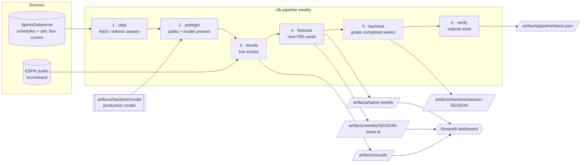
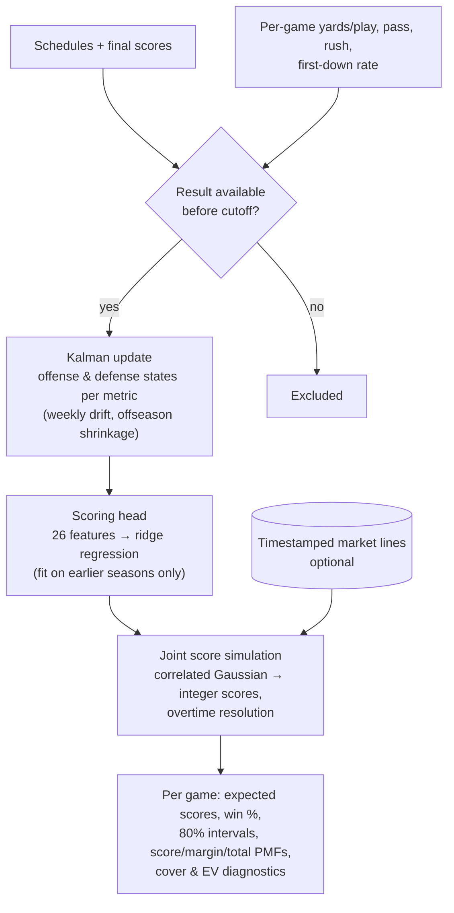
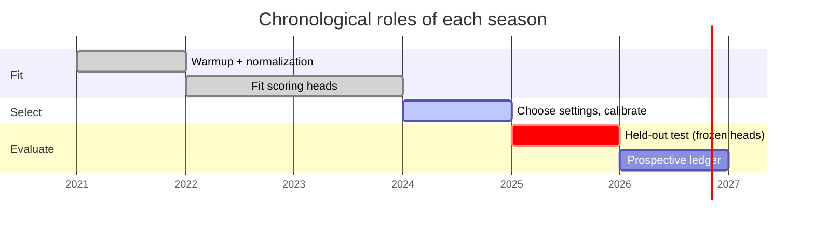

# CFB Forecast

Reproducible college football forecasting. The engine learns time-varying offense and defense strength for every FBS team, turns it into **joint score distributions**, and grades every prediction against games that had not yet been played when the forecast was made.

| | |
|---|---|
| **Inputs** | Free SportsDataverse schedules and ESPN advanced team box scores, plus ESPN live scores |
| **Model** | Kalman-filtered team states → ridge scoring head → correlated score simulation |
| **Outputs** | Expected scores, win probability, margin/total intervals and full score PMFs per game |
| **Guarantee** | Every forecast records its information cutoff, source hashes and model hash |
| **2025 held-out** | 73.0% winners, log loss 0.541 over 808 FBS games ([details](docs/RESULTS.md)) |

Forecasts are research outputs. The evaluation found **no** profitable betting edge.

---

## Pipeline

One command, `cfb-pipeline weekly`, runs the whole weekly cycle in-process. It works the same way on a laptop and inside the Docker image.



Dashed stages are **optional**. If one fails (for example, the ESPN scoreboard is unreachable), the failure is recorded and the run finishes as `degraded`. If a **required** stage fails, the run stops with a nonzero exit code. If refreshing the data fails while a cached snapshot exists, the run falls back to the cache.

| Action | Stages | Use |
|---|---|---|
| `cfb-pipeline weekly` | data → preflight → results → forecast → backtest → verify | The weekly run |
| `cfb-pipeline results` | data → results | Live scores on game days |
| `cfb-pipeline backtest` | data → preflight → backtest | Re-grade a season |
| `cfb-pipeline data` | data | Download or refresh inputs only |

Every run writes a receipt to `artifacts/pipeline/` with each stage's status, timing, errors and outputs.

## Quick start

### Local Python (3.11+)

```bash
make install                       # pip install -e ".[dev]"
make test                          # 25 tests
make weekly                        # refresh data, forecast the next week, grade the season
make dashboard                     # http://localhost:8501
```

### Docker

```bash
make docker-build                  # docker compose build: cfb-forecast:local + cfb-forecast-dashboard:local
make docker-weekly                 # runs the pipeline container as your user
make up                            # dashboard on http://localhost:8501
```

Configuration comes from environment variables. Defaults are in [`.env.example`](.env.example); copy it to `.env` to change them.

| Variable | Default | Meaning |
|---|---|---|
| `CFB_FORECAST_SEASON` | `2026` | Season to forecast |
| `CFB_FORECAST_DRAWS` | `50000` | Monte Carlo draws per game |
| `CFB_BACKTEST_LEAD_HOURS` | `48` | Backtest cutoff: hours before each week's first kickoff |
| `CFB_REFRESH_DATA` | `1` in Docker, `0` locally | Re-download season inputs before forecasting |
| `CFB_DATA_DIR` / `CFB_ARTIFACTS_DIR` | `./data` / `./artifacts` | Mounted input and output folders |
| `CFB_DASHBOARD_PORT` | `8501` | Dashboard port |
| `CFB_DOMAIN` | `localhost` | Hostname for the HTTPS proxy (`--profile public`) |

To publish the dashboard with automatic HTTPS, use `CFB_DOMAIN=forecast.example.org docker compose --profile public up -d`. Caddy reads [`deploy/Caddyfile`](deploy/Caddyfile).

### Scheduling

Runs are triggered locally, not through CI. During the season, run `make weekly` once a week (Monday morning works: the weekend's results are final). On game days, run `make results` every 15 minutes. You can drive both with cron, systemd timers or Windows Task Scheduler.

## How a forecast is made



Each season plays one role in the evaluation, so no year is used both to fit and to judge the model:



A game's result can update team states only if it became available **strictly before** the forecast cutoff. When the real completion time is unknown, it is approximated as kickoff + 8 hours. The prospective 2026 ledger gives each game its own fixed cutoff, 24 hours before kickoff, and freezes the exact inputs of every run ([CHRONOLOGY.md](docs/CHRONOLOGY.md)). The equations and data policies are in [METHODOLOGY.md](docs/METHODOLOGY.md).

## Results

**2025 held-out season.** 808 FBS-vs-FBS games, scored by heads fitted through 2024:

| Model | Winner accuracy | Log loss | Brier | Margin MAE | Total MAE |
|---|---:|---:|---:|---:|---:|
| Calibrated Elo | 69.55% | 0.5750 | 0.1965 | — | — |
| Score-state | 72.03% | **0.5377** | **0.1814** | 12.50 | **12.98** |
| PBP-state (selected) | **73.02%** | 0.5406 | 0.1830 | **12.41** | 12.99 |

Both state models beat Elo. The public forecast tracker in the archive still has lower probability error (0.5200 log loss across 763 matched games). See [docs/RESULTS.md](docs/RESULTS.md) for the paired bootstrap intervals and spread diagnostics.

**2026 season to date** (committed snapshot, `artifacts/backtest/season-2026/summary.json`): 215 graded games over 4 weeks, 80.9% winners, Brier 0.148, margin MAE 12.9.

## Command reference

All engine commands run as `cfb-forecast <command>` (or `python -m cfb_forecast <command>`). In Docker they run as `docker compose run --rm cfb-forecast <command>`.

| Group | Command | Purpose |
|---|---|---|
| Pipeline | `pipeline {weekly,results,backtest,data}` | End-to-end runs described above (`cfb-pipeline` is an alias) |
| Data | `fetch --seasons 2026 [--refresh]` | Download SportsDataverse inputs |
| | `results-refresh --season 2026` | ESPN live scoreboard snapshot |
| | `preflight --season 2026` | Validate data and artifact paths |
| Model | `backtest --archive data/archive/matched_predictions.csv` | Chronological fit, selection and 2025 evaluation (`make reproduce`) |
| | `distribution-backtest` | CRPS check of held-out score distributions |
| Forecast | `weekly-forecast --season 2026 [--week N]` | Next (or chosen) FBS week |
| | `forecast --as-of … --through … --season 2026` | Any explicit cutoff window |
| | `forecast-advance --previous DIR …` | Advance a frozen state when no new result is eligible |
| | `season-backtest --season 2026` | Re-forecast and grade every completed week |
| Market | `market-init`, `market-import`, `market-snapshot-sdv`, `market-backfill-sdv` | Timestamped line history ([template](examples/market_template.csv)) |
| Holdout | `holdout-freeze`, `holdout-settle`, `holdout-verify` | Immutable prospective slates |
| | `chronology-bootstrap`, `chronology-update`, `chronology-settle`, `chronology-verify` | Per-game 24-hour chronological ledger |
| | `prospective-run` | Market capture + ledger append in one step |

Run `cfb-forecast <command> --help` for every option.

## Repository layout

```text
cfb-forecast/
├── src/cfb_forecast/         engine package
│   ├── cli.py                  `cfb-forecast` command
│   ├── pipeline.py             `cfb-pipeline` stage orchestration and run receipts
│   ├── data.py                 ingestion, schema guards, source hashes
│   ├── features.py ratings.py  per-game metrics and Kalman team states
│   ├── model.py baseline.py    scoring head and Elo baseline
│   ├── simulate.py distribution.py  joint score simulation and PMFs
│   ├── forecast.py weekly.py   cutoff-aware forecasting
│   ├── backtest.py season_backtest.py evaluate.py  historical evaluation
│   ├── results.py              ESPN live scores
│   ├── market.py               timestamped market history
│   └── holdout.py chronology.py collector.py availability.py  prospective ledger
├── tests/                    unit tests (chronology, covariance, serialization, markets…)
├── dashboard/                Streamlit app + its Dockerfile
├── data/                     bundled 2021–2026 inputs, source manifest, archived public forecasts
├── artifacts/                fitted models, evaluations, frozen holdouts, forecasts
│   ├── backtest/model/         production model used by the pipeline
│   └── pipeline/               run receipts (git-ignored)
├── docs/                     METHODOLOGY · RESULTS · CHRONOLOGY
├── examples/                 market input template
├── deploy/Caddyfile          HTTPS reverse proxy for the dashboard
├── Dockerfile                engine image
├── docker-compose.yml        builds both images; cli · pipeline · dashboard · caddy (public profile)
├── Makefile                  common tasks (`make help`)
├── pyproject.toml            package metadata, entry points, pytest and ruff config
└── requirements-tested.txt   exact versions the bundled results were verified with
```

## Data sources

- [SportsDataverse `cfb_schedules`](https://github.com/sportsdataverse/sportsdataverse-data/releases/tag/cfb_schedules)
- [SportsDataverse `espn_cfb_adv_team`](https://github.com/sportsdataverse/sportsdataverse-data/releases/tag/espn_cfb_adv_team)
- [SportsDataverse `espn_cfb_pbp`](https://github.com/sportsdataverse/sportsdataverse-data/releases/tag/espn_cfb_pbp) (optional raw plays)
- [ESPN public scoreboard API](https://site.api.espn.com/apis/site/v2/sports/football/college-football/scoreboard)
- [ssmarathontrading/ncaa_predictions](https://github.com/ssmarathontrading/ncaa_predictions) (archived public forecasts, comparison only)
