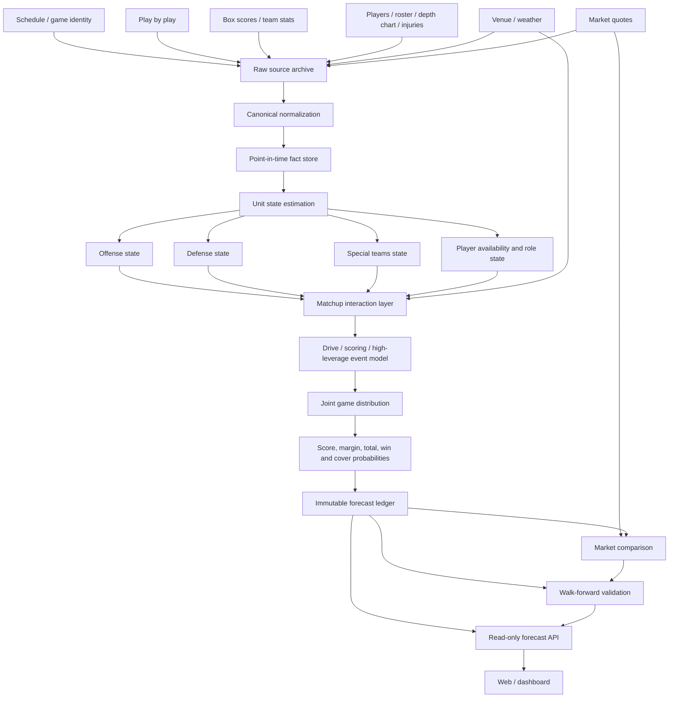

# Forecast Architecture V2

## Purpose

This repository has one job: produce auditable, point-in-time FBS game forecasts from real football information, preserve the exact information state used for every forecast, and measure whether each modeling change improves out-of-sample performance.

The Python forecasting package is the only authoritative forecasting implementation. User interfaces may read forecasts and diagnostics, but they must never calculate a second forecast with different logic.

## Non-negotiable rules

1. One authoritative model implementation lives under `src/cfb_forecast/`.
2. Every external observation is timestamped with both event time and retrieval time.
3. Every forecast has an immutable cutoff and a source manifest.
4. No post-cutoff result, injury report, depth chart, weather observation, market quote, or corrected statistic may enter a forecast.
5. Missing information remains missing. It is never converted into a healthy player, normal weather, zero injury impact, or synthetic market line.
6. The market is an evaluation and decision input, not a substitute for football strength.
7. Model selection is walk-forward and out-of-sample. A candidate does not enter production because it is more complex.
8. Forecast score, margin, total, winner probability, cover probability, and event probabilities must come from one coherent game distribution.

## System boundary



## Canonical data layers

### 1. Raw source archive

Raw responses are append-only and content-addressed. Every record has:

- `source_name`
- `source_url`
- `retrieved_at`
- `effective_at` when supplied by the provider
- `sha256`
- `schema_version`
- `season`
- `game_id`, `team_id`, or `player_id` when applicable

Raw provider responses are evidence, not model features.

### 2. Point-in-time fact store

The normalized fact store resolves provider records into stable football entities without destroying provenance. Facts are valid only when `available_at <= forecast_cutoff`.

Required fact families:

- game identity and kickoff
- team and conference membership
- play-by-play
- drives and possessions
- team box score statistics
- player participation and production
- roster and depth-chart role
- injury / availability status
- venue and neutral-site status
- weather observation / forecast
- kicking, punting, returns, blocks, field-goal range and touchback rates
- market spread, total and moneyline snapshots

### 3. Derived football features

Derived features are calculated from the fact store with an explicit cutoff. They are not stored as timeless season averages.

Offense:
- EPA/play where source fields allow reproducible calculation
- success rate
- explosive-play rate
- pass/rush efficiency
- havoc allowed
- sack rate and pressure proxy
- early-down efficiency
- third/fourth-down conversion
- red-zone touchdown rate
- starting field position
- pace and seconds/play
- drive efficiency

Defense:
- opponent-adjusted equivalents of the offensive measures
- pressure/sack creation
- explosive-play prevention
- red-zone defense
- turnover creation separated from turnover luck

Special teams:
- expected field position from kickoffs and punts
- punt block / allowed block rate
- punt return and kick return value
- field-goal make probability by distance
- long-snap / place-kick availability when reported
- special-teams touchdown and blocked-kick event rates

Player state:
- position
- depth-chart role
- snap/usage proxy
- recent workload
- efficiency contribution
- replacement-level estimate
- availability probability or categorical status
- unit-level loss after replacement rather than raw injury count

Context:
- venue
- neutral site
- altitude
- surface when available
- temperature
- wind and gusts
- precipitation
- rest
- travel
- rivalry / conference indicators only if they improve out-of-sample performance

## Unit-state model

The current five-metric team state is retained as a baseline, not the final representation. The production state should be hierarchical and unit-specific.

For team `i` at time `t`:

```text
state(i,t) = {
  offense: {
    pass,
    rush,
    explosiveness,
    success,
    protection,
    finishing,
    pace
  },
  defense: {
    pass,
    rush,
    explosiveness_allowed,
    success_allowed,
    pressure,
    finishing
  },
  special_teams: {
    punt,
    punt_return,
    kickoff,
    kick_return,
    field_goal,
    block_rate,
    block_allowed
  }
}
```

States evolve through time with partial pooling and opponent adjustment. Player availability changes the unit state before matchup calculation rather than being appended as a generic probability correction after the forecast.

## Player impact

An injury is not a scalar count. The relevant object is lost football value conditional on position, role, replacement, and matchup.

For player `p`:

```text
impact(p, game) = availability(p)
                * role_share(p)
                * player_value_above_replacement(p)
                * matchup_sensitivity(position, opponent)
```

Examples:

- starting LT unavailable -> pass protection and edge-pressure matchup change
- WR1 unavailable -> target distribution, explosive pass probability and third-down receiving change
- DT unavailable -> interior rush defense and pressure state change
- kicker unavailable -> field-goal decision and make distribution change

The system must retain the raw injury evidence and the numerical transformation used in the forecast.

## Matchup interaction layer

A team rating alone is insufficient. Forecast features must explicitly model how one unit meets another.

Examples:

```text
pass_matchup       = offense.pass - opponent.defense.pass
rush_matchup       = offense.rush - opponent.defense.rush
protection_matchup = offense.protection - opponent.defense.pressure
explosive_matchup  = offense.explosive - opponent.defense.explosive_allowed
punt_block_matchup = punt_protection - opponent.block_rate
fg_matchup         = kicker_range + venue_weather_adjustment
```

Nonlinear interaction models may be used only after walk-forward validation shows improvement over the simpler additive state model.

## Game distribution

The final engine should model how points are generated, not only regress final scores.

At minimum the game distribution must distinguish:

- offensive touchdowns
- field goals
- safeties
- defensive touchdowns
- special-teams touchdowns
- blocked kicks / punts
- turnovers that create short fields
- ordinary drives that end in punts or turnovers on downs

This is important because a final score can materially exceed offensive scoring performance. Defensive and special-teams scores should be low-frequency events with explicit probabilities, not unexplained residual noise.

A future drive simulator can be introduced behind the same distribution interface. Until then, the analytic distribution should expose separate expected components and event probabilities.

## Market layer

Market information is stored separately from football information.

The model first produces a football forecast. Market snapshots then produce:

- model minus market spread
- model minus market total
- no-vig market win probability
- model probability minus market probability
- closing-line value when a later quote exists
- realized ATS / moneyline / total result

Market prices must never silently alter the football forecast unless a separately validated market-residual model is explicitly selected.

## Forecast record

Every issued forecast is immutable and contains:

```text
game_id
forecast_id
model_version
model_hash
cutoff_utc
kickoff_utc
source_manifest_hash
feature_snapshot_hash
home_team_id
away_team_id
expected_home_score
expected_away_score
expected_margin
expected_total
home_win_probability
score_distribution_reference
margin_distribution_reference
total_distribution_reference
offensive_td_expectation
defensive_td_probability
special_teams_td_probability
turnover_short_field_probability
home_spread_at_cutoff
market_observed_at
```

The forecast ledger is append-only. A newer forecast for the same game creates a new `forecast_id`; it does not overwrite the earlier one.

## Validation

Validation is always performed against the forecast that actually existed at the cutoff.

Required metrics:

- winner accuracy
- log loss
- Brier score
- calibration
- margin MAE
- total MAE
- home and away score MAE
- CRPS for margin and total distributions
- interval coverage
- ATS result only when an eligible spread existed
- moneyline return only when an eligible price existed

Diagnostics are also broken down by:

- favorite strength
- conference / nonconference
- home / neutral
- weather severity
- injury-impact magnitude
- turnover / defensive-TD / special-teams-TD realization
- model-market disagreement

The point of the event diagnostics is not to excuse misses. It is to identify whether the distribution assigned appropriate probability to the path by which the actual game occurred.

## Application architecture

The repository currently contains both a Python forecasting implementation and a TypeScript forecasting implementation. That is an architectural error because the dashboard can produce numbers that are not the production Python model.

V2 removes that ambiguity:

```text
Python collectors -> Python feature store -> Python model -> immutable artifacts -> read-only API -> UI
```

The web application must never fit ratings, calculate a forecast, or backtest from live scoreboard data. It only renders authoritative saved output.

## Repository target layout

```text
src/cfb_forecast/
  domain/          # game/team/player identities and typed contracts
  ingestion/       # provider adapters and raw archival
  store/           # point-in-time fact store and manifests
  features/        # football feature construction
  states/          # dynamic offense/defense/ST/player states
  matchup/         # opponent and unit interactions
  distribution/    # score/event distributions
  forecast/        # authoritative forecast orchestration
  market/          # quotes and market comparison
  validation/      # walk-forward scoring and calibration
  service/         # read-only API over saved forecasts

app/               # presentation only
artifacts/          # runtime output, never hand-edited source
```

The existing modules can move incrementally behind these boundaries. There is no requirement to rewrite a working mathematical component merely to change folders.

## Migration order

1. Eliminate the duplicate TypeScript forecasting engine from the production path.
2. Make the Python run output the only forecast source for every UI.
3. Freeze canonical data contracts and forecast IDs.
4. Expand the fact store for player, injury, weather, venue and special teams information.
5. Replace injury-count adjustments with position/role/replacement impact.
6. Add explicit special-teams and defensive-scoring event probabilities.
7. Add richer PBP efficiency and drive features.
8. Evaluate matchup interaction candidates by walk-forward validation.
9. Add a drive-level simulator only after the upstream state and event models are stable.
10. Promote components only when the measured holdout improves.
